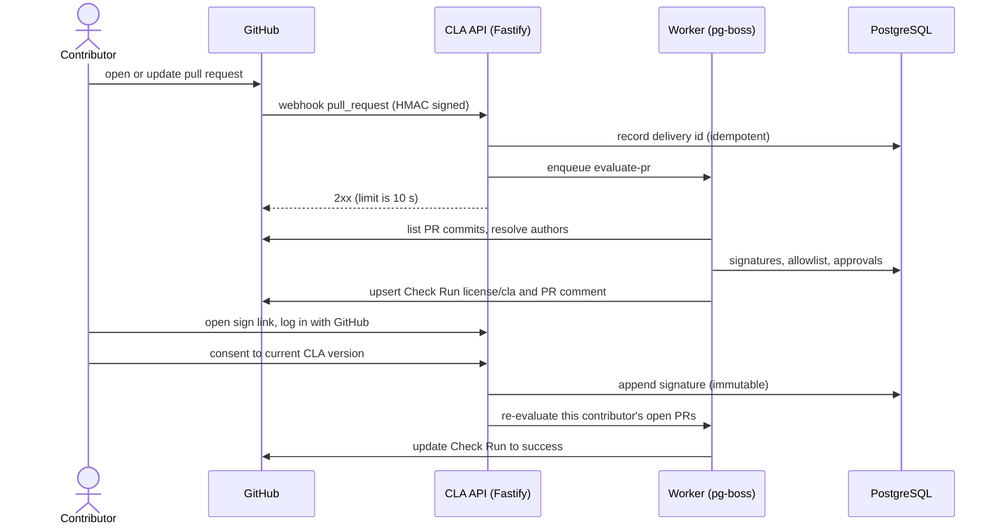

# Architecture

How the service is built and the rules the code must follow. [`README.md`](../README.md) has the short overview. The cross-cutting rules every change must respect are repeated in [`CLAUDE.md`](../CLAUDE.md); the schema is in [`data-model.md`](data-model.md), authentication and authorization in [`security.md`](security.md), the GitHub App in [`github-app.md`](github-app.md) and the directory tree in [`repository-layout.md`](repository-layout.md).

## Stack

| Layer | Choice |
|---|---|
| Runtime | Node.js 26 LTS (26.13.0 "Lithium", LTS since 2026-10-28), ESM only |
| Package manager | Yarn 4 (Berry) via Corepack, `nodeLinker: node-modules` |
| Language | TypeScript `~6.0.x`, strict (see [Decisions](decisions.md#decisions)) |
| Web | React 19.3, Vite 8 (Rolldown), TanStack Router (code-based) and Query 5, React Hook Form + zod, Tailwind CSS 4, `radix-ui` primitives |
| API | Fastify 5, `fastify-type-provider-zod` + zod 4, `@fastify/cookie`, `helmet`, `rate-limit`, `csrf-protection`, `fastify-raw-body`, `@fastify/static` |
| Database | PostgreSQL 18, Kysely, forward-only SQL migrations |
| Jobs | pg-boss (queue lives in Postgres, no Redis) |
| GitHub | GitHub App, `octokit` + `@octokit/webhooks` (ESM only) |
| Tests | Vitest 5 (`scripts`, `server` and later `web` projects), Testing Library, MSW 3, PGlite, Playwright |
| Deploy | Single container: Fastify serves API and the built SPA from one origin |

## Layering

```text
src/server/domain     pure functions (PR evaluation, coverage rules) - no I/O
src/server/services   orchestration, depends on ports
src/server/adapters   github/, db/, http/ routes, jobs/ - the only places with I/O
src/web               React SPA, talks to the API only through src/shared schemas
src/shared            zod schemas and API contract types; imports neither server nor web
```

Boundaries are enforced by ESLint, one block per directory (`scripts/eslint-layers.ts`, with a test that lints real snippets for every direction); the first two bullets under [Rules](#rules) give the details, including the allow-list of `src/server/domain`. Keeping the decision logic pure makes the 100% coverage and mutation gates cheap to satisfy honestly.

## How a pull request is checked



A PR passes when the **PR opener** and every non-exempt **commit author and committer** is linked to a GitHub user with a valid signature for the repo's active CLA. Covered means: same document, and the signature's major version equals the active major (minor edits never force re-signing). Commit emails are spoofable (anyone can commit as a signer's `ID+login@users.noreply.github.com`), which is why the opener must always be covered too. The committer is exempt when it equals the author or is GitHub's `web-flow` identity (id to verify at scaffold); merge commits are skipped. With corporate CLAs (later), a valid individual signature **or** a valid corporate approval covers an author.

Outcomes: `success` (all covered), `failure` (unsigned authors and unlinked emails, listed with exact fix steps), and `in_progress` while a job runs. Each evaluation records its covering basis (signature, approval, allowlist rule or override) in `pr_evaluations`. A null commit author means an unlinked email: a blocking failure unless a maintainer records an audited per-commit override (repo plus commit SHA), which never implies a signature. `Co-authored-by` trailers carry only name and email, so they are resolved only in the `ID+login@users.noreply.github.com` form; otherwise they are advisory notes, never blocking. Bot and AI trailers are ignored. PRs with more than 250 commits fall back to paging the repo commits endpoint (the PR commits endpoint caps at 250). Jobs always re-fetch current PR state and never trust the webhook payload.

## Rules

- `src/shared` imports neither `src/server` nor `src/web`. `src/web` never imports `src/server` and vice versa. Enforced by ESLint only (Knip does not check layering): one block per directory in `scripts/eslint-layers.ts`, appended at the end of `eslint.config.mjs`; a later block REPLACES the rule for its files, so each block repeats what it inherits. The patterns are regular expressions on RELATIVE specifiers (a glob on the bare name would also reject `node:stream/web` and `react-dom/server`), dynamic `import()` is covered by `no-restricted-syntax` selectors (`no-restricted-imports` ignores it), and `scripts/eslint-layers.test.ts` lints real snippets for every direction with the real blocks.
- Decision logic (PR evaluation, signature coverage, allowlist matching) lives in `src/server/domain` as pure functions with no I/O. I/O only in `src/server/adapters`. Inside `src/server/domain` ESLint uses an allow-list, not a deny-list of I/O modules: only its own files (no `..`), `src/shared` and `zod` may be imported (so no Node built-in at all, no I/O package, and nothing of `app`, `boot`, `config`, `adapters`, `services` or `src/web`), no dynamic `import()`, no `fetch`, `process`, `require`, `WebSocket`, `XMLHttpRequest` or `EventSource`, and no property access on `globalThis`, `global`, `self` or `window`. Extend the allow-list in `scripts/eslint-layers.ts` (with a test) when a pure module is really needed.
- Validate every external input (HTTP, webhook payloads, GitHub API responses, env) with zod at the boundary. Share schemas through `src/shared`.
- Webhook handler order: verify HMAC on the **raw body** with `crypto.timingSafeEqual`; in **one transaction** insert the `webhook_deliveries` row and enqueue the job; dedupe on `processed_at`; return 2xx. No GitHub API calls in the request path (10 s limit). Accept two webhook secrets during rotation. Jobs re-fetch PR state and never trust the payload.
- Concurrency: serialise evaluation per (repo, PR) **without dropping newer sends**. pg-boss `short` and `exclusive` policies drop a second send; pick a policy that queues per key (check the pg-boss policy docs; candidates are `singleton` or `key_strict_fifo`). The job reads the current head SHA at run time, re-checks it before writing the Check Run and comment, and reads signatures last. PGlite is single-connection, so concurrency tests run against real Postgres.
- `issue_comment` handling: `created` only, issue must be a PR, sender must not be a Bot, a line must be exactly `/recheck`, rate-limited per PR. Also handle `check_run` and `check_suite` `rerequested`, and `pull_request` `closed` (prune pending work). A scheduled sweep re-evaluates open PRs to catch missed deliveries.
- Check Run name is the constant `license/cla`. Do not rename it.
- PR evaluation: the PR opener **and** every non-exempt commit author and committer must be covered (commit emails are spoofable). Committer is exempt if equal to author or GitHub `web-flow`; merge commits are skipped. Covered = same document and signature major equals the active major. List PR commits (cap 250, then page repo commits); use author and committer numeric ids. A `null` or `{}` author means an unlinked email: a first-class failure state with fix instructions, overridable only by an audited per-commit `commit_overrides` row that never implies a signature. `Co-authored-by` trailers have no numeric id: resolve only the `ID+login@users.noreply.github.com` form, otherwise advisory only; ignore bot and AI trailers. Classify bots from the PR opener's account type plus numeric id or app slug, never from email or login strings. Record the covering basis in `pr_evaluations`.
- Authorization: use the installation token and numeric ids to check org role or repo permission, cached with a short TTL. Every query filters by installation id; cross-tenant tests are mandatory. Role matrix is in [Auth model](security.md#auth-model).
- Output encoding: CSV export prefixes cells starting with `=`, `+`, `-`, `@`, tab or CR. PR comments and check summaries escape markdown, wrap names in code spans, neutralise `@` and `#`. Hostile-name tests are mandatory.
- Cookies: `__Host-` prefix, `HttpOnly`, `Secure`, `SameSite=Lax`, idle and absolute expiry. Login uses a short-lived Lax state cookie plus PKCE, a **new session id** at the callback, relative-only `return_to`, no mutation on GET. CSRF token plus `Origin` check on state changes; the webhook route is exempt and relies on HMAC only. Delete sessions on a `github_app_authorization` revoke event. Set `trustProxy` correctly or rate limits key on the proxy IP.
- SPA is served by Fastify from the same origin. No tokens in `localStorage`.
- Poison jobs: bounded `retryLimit` plus a dead-letter handler that sets the Check Run to `failure` with a `/recheck` hint.
- Network metadata (IP, user agent) is not recorded unless an explicit config flag enables it. That includes the log: the request serializer in `src/server/adapters/http/logger.ts` emits method and path only (never headers, cookies, query string, body or client address), and a test pins it.
- Server start-up order (`src/server/boot.ts`): `loadConfig(process.env)` (invalid variables are reported by NAME, exit code 1), logger, database, `buildApp`, `listen`, then SIGINT and SIGTERM close the app, which destroys the database; open requests get `shutdownTimeoutMs` (10 s) before their connections are dropped and the exit code becomes 1, and a second signal drops them at once. The HTTP limits (timeouts, keep-alive, 1 MiB body) are explicit in `adapters/http/limits.ts`; failures that never reach a route (bad URL escape, parser errors, oversized headers) are answered by `adapters/http/framework-errors.ts` with the same body, request id and security headers. The runtime connects as `cla_app` (`DATABASE_URL`); only `yarn db:migrate` uses the owner (`MIGRATION_DATABASE_URL`). Wrap every secret in `Secret` (`reveal()` is the one explicit way out). Error responses never carry an exception message.
- No legal text ships by default; maintainers upload their own CLA.
