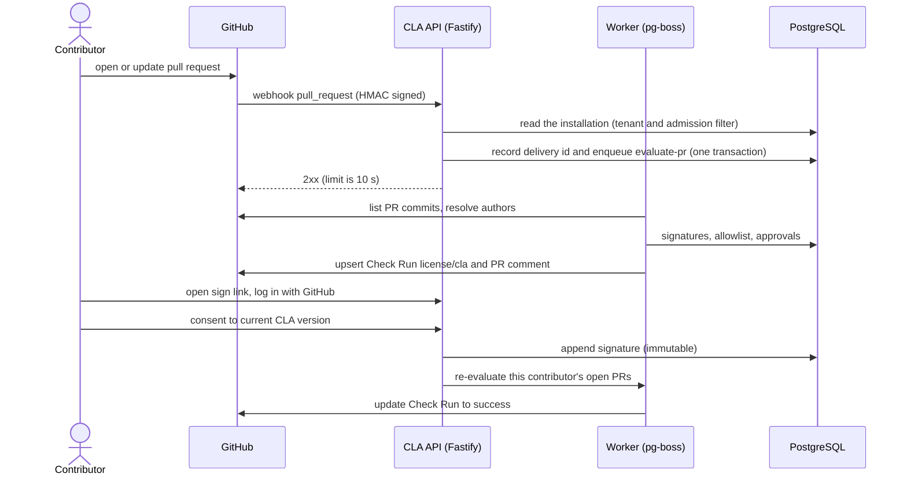

# Architecture

How the service is built and the rules the code must follow. [`README.md`](../README.md) has the short overview. The cross-cutting rules every change must respect are repeated in [`CLAUDE.md`](../CLAUDE.md); the schema is in [`data-model.md`](data-model.md), authentication and authorization in [`security.md`](security.md), the GitHub App in [`github-app.md`](github-app.md) and the directory tree in [`repository-layout.md`](repository-layout.md).

## Stack

| Layer | Choice |
|---|---|
| Runtime | Node.js 26 LTS (26.13.0 "Lithium", LTS since 2026-10-28), ESM only |
| Package manager | Yarn 4 (Berry) via Corepack, `nodeLinker: node-modules` |
| Language | TypeScript `~6.0.x`, strict (see [Decisions](decisions.md#decisions)) |
| Web | React 19.3, Vite 8 (Rolldown), TanStack Router (code-based) and Query 5, React Hook Form + zod, Tailwind CSS 4, `radix-ui` primitives |
| API | Fastify 5, `fastify-type-provider-zod` + zod 4, `@fastify/cookie`, `helmet`, `rate-limit`, `csrf-protection`, `fastify-raw-body`, `@fastify/static` |
| Database | PostgreSQL 18, Kysely, forward-only SQL migrations |
| Jobs | pg-boss (queue lives in Postgres, no Redis) |
| GitHub | GitHub App, `octokit` + `@octokit/webhooks` (ESM only) |
| Tests | Vitest 5 (`scripts`, `server` and later `web` projects), Testing Library, MSW 3, PGlite, Playwright |
| Deploy | Single container: Fastify serves API and the built SPA from one origin |

## Layering

```text
src/server/domain     pure functions (PR evaluation, coverage rules) - no I/O
src/server/services   orchestration, depends on ports
src/server/adapters   github/, db/, http/ routes, jobs/ - the only places with I/O
src/web               React SPA, talks to the API only through src/shared schemas
src/shared            zod schemas and API contract types; imports neither server nor web
```

Boundaries are enforced by ESLint, one block per directory (`scripts/eslint-layers.ts`, with a test that lints real snippets for every direction); the first two bullets under [Rules](#rules) give the details, including the allow-list of `src/server/domain`. Keeping the decision logic pure makes the 100% coverage and mutation gates cheap to satisfy honestly.

## How a pull request is checked



A PR passes when the **PR opener** and every non-exempt **commit author and committer** is linked to a GitHub user with a valid signature for the repo's active CLA. Covered means: same document, and the signature's major version equals the active major (minor edits never force re-signing). Commit emails are spoofable (anyone can commit as a signer's `ID+login@users.noreply.github.com`), which is why the opener must always be covered too. The committer is exempt when it equals the author or is GitHub's `web-flow` identity (id 19864447, verified 2026-11-02 with `GET /users/web-flow`); merge commits are skipped. With corporate CLAs (later), a valid individual signature **or** a valid corporate approval covers an author.

A repository checks pull requests only while it is enabled (`repositories.enabled`, set by a maintainer, [below](#repository-enablement-and-the-allowlist)): the evaluation re-reads it before it writes and after, hands a switched-off repository's pull request to a `finalise-check` job and so leaves the check `neutral`, never `failure` or `in_progress`.

Outcomes: `success` (all covered), `failure` (unsigned authors and unlinked emails, listed with exact fix steps), and `in_progress` while a job runs. Each evaluation records its covering basis (signature, approval, allowlist rule or override) in `pr_evaluations`. A null commit author means an unlinked email: a blocking failure unless a maintainer records an audited per-commit override (repo plus commit SHA), which never implies a signature. `Co-authored-by` trailers carry only name and email, so they are resolved only in the `ID+login@users.noreply.github.com` form; otherwise they are advisory notes, never blocking. Bot and AI trailers are ignored. PRs with more than 250 commits fall back to paging the repo commits endpoint (the PR commits endpoint caps at 250), up to 2,000 commits; above that the PR fails closed with `commit_limit_exceeded` and the fix `split_pull_request`. Jobs always re-fetch current PR state and never trust the webhook payload.

## The GitHub App core

Every call to GitHub goes through the port `src/server/services/ports/github.ts`; the domain and the services never import Octokit. There are two implementations of it, the Octokit adapter (`adapters/github/octokit-client.ts`) and an in-memory fake, and one contract suite runs against both from one test per implementation. Every response is parsed with zod before it leaves the adapter (`adapters/github/schemas.ts`).

An installation token is obtained in one place, `GitHubApp.installationTokens`:

1. the installation gate (`InstallationGate`, `services/installation-gate.ts`) refuses a rejected, deleted, suspended or unknown installation before any request; it reads the stored row and asks the admission policy in force now, so a policy that no longer serves an account stops it at once;
2. the token cache (bounded, in memory, a token is reused until shortly before it expires) answers, or a single flight makes the concurrent callers of one installation share one mint;
3. the mint is `POST /app/installations/{id}/access_tokens`, signed with the App JWT (the current key, then the previous one when GitHub answers 401), and it goes through the rate limiter like any other call.

The gate is late-bound: it is the closed gate until the database is open and the admission policies are built, and then the stored gate. The evaluation job (E07) must ask it, because the pure `evaluationEligibility` reads stored state only; the gate is what also reads the live policy.

The rate limiter (`adapters/github/rate-limiter.ts`) is the only thing that decides how GitHub is paced, one lane per installation plus one for the App itself (`GET /app` and the check on start-up). A request waits for a lane slot (10 in flight per lane, 50 overall), for the 1 s spacing a write needs (a POST, PATCH, PUT or DELETE costs 5 points) and for a block GitHub announced (`retry-after`, `x-ratelimit-reset`, a secondary limit). It sleeps for at most 60 s and at most twice, then raises `GitHubRateLimitedError`; each sleep logs one `github.rate_limited` WARN. Octokit's own throttling and retry plugins are off. A GET that failed with a transient error is repeated after 1 s and 2 s; a POST is not repeated by the client.

Installation state: an installation is a row of `installations` keyed on the numeric GitHub installation id; `admission_status`, `deleted_at` and `suspended_at` say whether it is served (`installationEligibility`, and for a repository `evaluationEligibility` with the reasons `installation_rejected`, `installation_deleted`, `installation_suspended`, `repository_removed`, `repository_disabled`). The admission decision is the pure function `decideAdmission` in `domain/admission.ts` (the App owner is always served, then the numeric ids of `GITHUB_ALLOWED_ACCOUNT_IDS`; anything else, and any account that is not a user or an organisation, is rejected). The sync (`installation-sync*.ts`) reads the installations and each one's repositories from GitHub and writes in two transactions with the fetch between them; `reconcileOnStart` runs it once for every installation GitHub lists and marks the ones it no longer lists as deleted. Every write is one audit row in the same transaction. A repository is active under at most one installation: a repository that moves to another one is released by the new tenant's sync, and its row under the new tenant is a new row. An uninstall sets `deleted_at`; a repository that left sets `removed_at`; nothing is deleted.

## The evaluation engine

`src/server/domain/evaluation` is the whole decision as one pure function, `evaluatePullRequest(input)`, over plain facts: the opener, the commits, the policy, the signature facts, the allowlist, the known org members and the per-commit overrides. Its public surface is `index.ts` (a test pins the list of exports). The rules, in the fixed order the function runs them:

- **Actors.** The opener is always an actor. A commit with more than one parent is skipped (author, committer and trailers). The author is an actor; the committer is one unless it equals the author or is `web-flow`. A person with several roles is one actor. Commit SHAs are lower-cased everywhere, so case never matters.
- **Co-authors.** `Co-authored-by` trailers are the only text the engine matches, confined to `trailers.ts` and `trailer-identities.ts` (text is spoofable, so it can only add requirements). Only the final paragraph is read, at most 20 trailers per commit. Only the `ID+login@users.noreply.github.com` form resolves (to an actor of role `co_author` and type `Unknown`); every other trailer is an advisory `co_author_unresolved`, and bot and AI trailers (a login ending in `[bot]`, `noreply@anthropic.com`, Copilot) are ignored. The accounts that only trailers name are capped at 200 per PR (the lowest ids are kept, the commit that named a dropped one gets `too_many_trailers`); advisories are unique per commit and code.
- **Unlinked identities.** An author or committer GitHub could not link to an account is waived only by an audited per-commit override matched by lower-case SHA. The override is not an input to coverage and never implies a signature. Fixes name the SHA and role, never an address.
- **Coverage.** Only a person (a `User`, or an `Unknown` co-author) can be covered by a signature: same document, signature major equal to the active major, not revoked, lowest signature id wins. A `Bot`, `Organization` or `Mannequin` needs an allowlist entry. A signature beats an allowlist match as the stored basis. Allowlist entries match by numeric id: a `user` entry covers any account but a bot (including `Organization` and `Mannequin`, whose fix is `allowlist_account`), a `bot` entry covers `Bot` and `Unknown`, and `org_members` covers only `User` and `Unknown` of a known member. When several entries match: repository scope before installation scope, then kind `user`, `bot`, `org_members`, then the lowest entry id. An org with no membership fact has no members, so the job (E07-S04) must fail when a membership lookup fails instead of passing partial facts. Signatures and the allowlist are indexed once per evaluation, so the cost of an actor does not grow with them.
- **Listing.** `planCommitListing` chooses `pull_commits` (up to 250 commits, pages of 100), `repo_walk` (251 to 2,000, at most 25 pages of 100) or `refuse`. `collectRepoWalk` lists what the head reaches and the merge base and everything behind it do not; `verifyListing` compares the result with the count GitHub reports. A history with several merge bases (a criss-cross merge) lists too many commits and ends as a count mismatch, which fails closed. An exceeded listing fails with `commit_limit_exceeded` and `split_pull_request` without reading the commits; the limits are the constants of `listing-plan.ts`. With no active CLA the one failure code is `no_active_cla`.
- **Stored value.** `toStoredDetails` is the only writer of `pr_evaluations.details`. The schema (`src/shared/pr-evaluation-details.ts`, version 1, strict) holds numeric ids and codes only and bounds every list (500 actors, 500 unlinked findings, 500 advisories, so a row stays under 256 KiB); the uncovered actors and the findings without an override are kept first and `omitted` counts the rest, while the outcome and the failure codes always come from the full evaluation. Fixes are not stored: they are recomputed from the facts when a page is rendered, and the renderer (E09) must bound its own output.

## The job queue

The queue is pg-boss in the application's own Postgres (`pgboss` schema, no Redis). Everything below is E07; the code is in `src/server/adapters/jobs/` (pg-boss), `src/server/services/` (handlers, pure of pg-boss) and `src/server/domain/` (envelopes, rules).

- **Start-up and readiness.** The queue starts after the database: pg-boss starts as the runtime role `cla_app` with `schedule: false` and `reindex: false`, every queue of `QUEUE_DEFINITIONS` must exist with its policy (otherwise boot exits 1 naming the queues, or the wrong policy), then the workers start. `/readyz` reads the queues on every call and is `503` while one is missing or pg-boss has stopped or reported an error. `onClose` stops the queue (graceful, 30 s) before the database is destroyed. The schema and the queues belong to `yarn db:migrate` (second step, as the owner); see [Data model](data-model.md) and [Operations](operations.md).
- **Queues** (twelve names, one per job type plus the sweep and repository jobs and the dead letter): `evaluate-pr` (singleton, key `${githubRepoId}:${prNumber}`), `evaluate-head-sha`, `close-pr`, `recheck-comment`, `sync-installation`, `revoke-user-sessions`, `sweep` (exclusive: one at a time, a tick that finds one running sends nothing), `sweep-installation`, `sweep-repository` (standard), `finalise-repository` (singleton, key `${githubRepoId}`), `finalise-check` (singleton, key `${githubRepoId}:${prNumber}`, the key of `evaluate-pr` in a queue of its own) and `job-dead-letter`. A policy cannot change on an existing queue: migrate and boot refuse a queue whose policy differs from the list.
- **Sending.** `PgBossEnqueuer` implements the `JobEnqueuer` port of E06 on the connection of the caller's transaction, so a job commits or rolls back with the `webhook_deliveries` row. It answers `queued`, `already_queued` (a live job holds the idempotency key) or `deduplicated` (a limit dropped the send) and passes the shared contract suite `services/jobs-contract` on the fake and on real Postgres. The job id is a deterministic UUID made from the idempotency key; a finished job under that id is deleted and sent again, so a redelivery after a dead-letter is not lost. A send carries at most one of two limits: a **coalesce key** drops the send only while a job of the same key waits (`created` or `retry`), because that job reads the state when it starts (policy, pull request); a job that is running or over does not stop it, since it may have read the state before the change. A **rate limit** (`dedupeKey` and `dedupeWindowSeconds`) is pg-boss's throttle slot, an epoch-aligned window in which the first send wins whatever became of its job; it is used for `/recheck` and the Re-run of a check. pg-boss has one `singletonKey` per job, so on a serialised queue both limits work per serialisation key, whatever key the sender names.
- **Handlers.** `HandlerRegistry` (`services/job-registry.ts`) maps a job type to a handler and `registerHandlers` (`services/job-handlers.ts`) registers the ones E07 owns. A later epic registers its handler with `registry.register(type, handler)` through the `register` option of `jobWorkers` in `boot-jobs.ts`, without editing any E07 file: E10-S07 registers `revoke-user-sessions` that way, E14-S04 `finalise-repository` and `finalise-check`, and the dead-letter table already has a log-only row for each. A queue whose type has no handler gets no worker and keeps its jobs. A handler gets a `JobContext` with the job id, the attempt, an `AbortSignal`, the logger, `pending` (the queue's own jobs, to find and cancel) and `enqueuer` (to send jobs).
- **The wrapper.** `runJob` (`services/job-run.ts`) validates the data against the envelope of the type (`domain/job-envelope.ts`; invalid data is terminal, goes to the dead-letter queue with no retry, and logs `job.payload_invalid`), logs `job.started`, `job.finished` and `job.failed`, runs the handler, and marks the delivery processed only when the handler completed and its signal was not aborted. Identity in an envelope is the numeric GitHub id. `WORKER_CONCURRENCY` is how many jobs of one queue run at once in this process, so the total is that number times the queues that have a handler. A promise that a handler starts, does not wait for and that rejects fails the job it came from and does not stop the process (`rejection-guard.ts`: one process listener of `unhandledRejection` finds the job through the async context and logs `job.unhandled_rejection`); a rejection that belongs to no job is thrown again, as Node does without a listener.
- **Shutdown.** SIGTERM or SIGINT: HTTP closes first (its 10 s deadline covers requests only), then `boss.stop` is graceful for 30 s, then the database is destroyed. A job still running at the end of the grace period is aborted through its signal, runs again after the restart and the exit code is 1. `GitHubClient.withSignal` carries the signal into the GitHub calls. A handler whose ports are not configured (no GitHub App, or no evaluation reporter) is registered as an `unavailable` handler that fails its job with the reason named, so the job retries and then dead-letters instead of being dropped or marked processed.
- **`evaluate-pr`** (`services/evaluate-pr/`, E07-S04): the job names a pull request by numeric ids and is told nothing else; everything it decides on is read now, from GitHub and from the database, in eight steps: the repository (its name may have changed; no GitHub call when the installation or repository is not evaluated), the pull request (a closed one ends `skipped:pull_request_closed`), the `in_progress` row and the report that it began, the commits, the policy facts (and, for an author who is not allowlisted, the organisation membership, cached per process), the signatures read last, the pure engine of E08, and the pull request again. The last read decides whether the verdict may be written: a push or a close during the run discards it (`superseded`), because the Check Run is per head SHA and the push that moved the head sent a delivery of its own. A `pull_request` delivery for a head SHA that already has a final result and a Check Run is answered by what is there, so ten `edited` deliveries are one evaluation; every other trigger, and any retry (`attempt` above 0), looks again. Outcomes are `evaluated`, `superseded`, `unchanged` and `skipped:<reason>`. The `EvaluationReporter` port is implemented by `CheckRunReporter` ([Reporting](#reporting)); `boot-evaluation.ts` binds it to the `evaluation` option of `jobWorkers` in `boot-jobs.ts` whenever a GitHub App is configured, and without one the evaluation is not wired.
- **`close-pr`** (`services/close-pr/`): `loadTenant`, the repository, `getPullRequest` (open ends `skipped:pull_request_open`), then the waiting or retrying `evaluate-pr`, `recheck-comment` and `evaluate-head-sha` jobs of the pull request are found with `findJobs(data, queued)` and cancelled, and each `in_progress` row is reported cancelled by the reporter and then set to `cancelled` (migration 008). A `cancelled` row is not final, so a reopened pull request is evaluated again from it. A race stays: an `evaluate-pr` already past its second step when the close lands can leave an `in_progress` row on a closed pull request, which the sweep's reaper covers (it calls `prunePullRequest`).
- **`/recheck` and Re-run** (`services/recheck/`): the `recheck-comment` job fetches the comment again and applies the rules to what GitHub returns (not a Bot, on a pull request, open, the installation and repository evaluated, one line exactly `/recheck`). Re-run lists `commits/{sha}/pulls` (the first 100), keeps the open pull requests whose head is the SHA (at most 20) and sends `evaluate-pr`. Both are rate limited under `recheck:<repoId>:<pr>`, 60 s: the webhook intake sends the `recheck-comment` job under the limit (so the second comment of a minute spends no GitHub call), and the `evaluate-pr` send is under the same key, shared by `/recheck` and Re-run. A send that is dropped is logged `recheck.rate_limited` and gets no reply.
- **Sweep** (`services/sweep/`): the pg-boss schedule (`SWEEP_INTERVAL_MINUTES`, kept by pg-boss's scheduler through its queue `__pgboss__send-it`) sends `sweep`; `sweep` reconciles the installations and sends one `sweep-installation` per served installation, coalesced per installation; `sweep-installation` lists the open pull requests (at most ten pages of 100, newest first), sends `evaluate-pr` with the trigger `sweep` for each one that has no result for its head SHA, coalesced per pull request, and runs the reaper for evaluations `in_progress` longer than 30 minutes (a closed pull request is pruned, one at another head is cancelled, one still open is evaluated again). A rate limit fails the job; a failure of one repository does not. The sweep is scheduled only when the App and a reporter are configured.
- **Repository-level jobs** (E07-S09): a change of policy sends `sweep-repository` (reasons in `domain/repository-jobs.ts`), coalesced per repository, whose run sends `evaluate-pr` with the trigger `policy_change`; turning enforcement off sends `finalise-repository` and `finalise-check`. Callers (E12, E14, E15) send through `enqueueSweepRepository`, `enqueueFinaliseRepository` and `enqueueFinaliseCheck` (`services/repository-job-enqueue.ts`) in their own transaction with an idempotency key (the id of their audit row, for instance). E14-S04 registers the two finalise handlers.
- **Retries and the dead letter.** Every queue has the same bounds: five retries, a 30 s backoff doubling with jitter, 300 s of expiry, a finished job (completed, failed or cancelled) deleted after 7 days and one that never ran after 14 days (pg-boss 12 has no archive step: it keeps a job in its table until it deletes it). The dead-letter handler of a job type: `evaluate-pr` and `evaluate-head-sha` set the row to `failure` (an `evaluate-pr` leaves a row that already holds a verdict alone) and complete the Check Run with the `/recheck` hint through `EvaluationReporter.failed`; `sync-installation` appends the audit action `installation.sync_failed`; the sweep, `sweep-repository`, `finalise-*`, `recheck-comment`, `close-pr` and `revoke-user-sessions` are logged at error only (`dead_letter_unhandled` when the handler itself fails) and the next re-enable, disable, `/recheck` or sweep repeats the work.

## Reporting

What the worker writes to GitHub (epic E09): the `license/cla` Check Run of a head SHA and the one comment of a pull request. The effects are in `services/reporting/`, every sentence and every encoding in the pure `domain/reporting/`.

- **The port and its outcomes.** `EvaluationReporter` has `started(target)`, `publish(target, evaluation, names)`, `failed`, `cancelled` and `enforcementDisabled` (called by `finalise-check`, E14-S04), each answering `reported` or `skipped` (`repository_gone`, `installation_unavailable`: an answer, never a throw). A rate limit, an outage and a refused credential are thrown as they are, for the queue to retry; a 422 to the full output is written again once with the minimal output (the counts and the `/recheck` hint, no name); a second 422, or a 403 on a Check Run call (`checks_permission_missing`), is a `ReportRejectedError`. Every report is idempotent, because a retried job repeats it. The reporter never calls `getPullRequest` (the job re-checks the head before `publish`), and the SHA written is always `target.headSha`.
- **The run of a head SHA.** `started` makes sure the SHA has an `in_progress` run: none means `POST` with the id of the `pr_evaluations` row as `external_id`; a run that is not completed is reused, so a job retried after a crash makes no second run; a completed run is left as it is, except for `check_rerequested` and `recheck`, which get a fresh run found through the listing of the SHA and never through the id the row stores (that id is the previous verdict's, and a run an earlier attempt made and crashed before recording is newer). `publish` writes the verdict to the run, then to the comment. The id of the run is stored on the row (`recordCheckRunId`, the only writer of `check_run_id`).
- **Pull requests that share a head SHA.** The run belongs to the SHA, so its conclusion is the worst result among the rows of the pull requests that stand at it: `failure` over `in_progress` over `success`. A pull request counts only while it stands there (`liveSiblings`): a `cancelled` row, a row whose pull request has a row touched later at another head SHA (`superseded`), and a pull request GitHub lists for the commit as closed or with another head SHA, count for nothing, because a finished row of a closed pull request is never rewritten. A pull request GitHub does not list stays in, so a listing that misses a failing pull request never turns its check green. A finished verdict is also written to the newest run of the App on the SHA when two pull requests that started together each made one. `cancelled` completes the run only when no other pull request is open at the SHA; otherwise it leaves the run to one still being evaluated, or completes it with the worst of the remaining rows (`settledView`, the counts of a pass read from the stored details).
- **The comment.** One comment per pull request, edited in place, with `<!-- cla-platform:license/cla:v1 -->` as its first line. It is found by the id the database holds, then by the oldest comment that begins with the marker and that GitHub says was posted through this App (a forged marker fails the second test), and created only for a failure; a pass edits a comment that exists and never opens one. Before any write `hasNewerHeadRow` asks whether a newer head SHA of the pull request has been evaluated, and then the comment is left to that job (`comment_skipped_stale`). A 403, 404 or 422 on the comment costs the comment only (`comment_skipped`).
- **The words.** A failure lists the unsigned people (`### Not signed`), the unlinked commits (`### Email not linked to a GitHub account`), the exact fix steps and the unresolved co-author trailers under `### Not blocking`, with the sign link `PUBLIC_BASE_URL/sign/{githubRepoId}?pr={prNumber}` (also the `details_url` of the run). Titles stay under GitHub's 100 characters and summaries and comments under 60,000 UTF-16 units, with at most 50 entries per list and a visible line for what was cut. The logins and trailer names come from `DisplayNames`, which the job builds from the data it fetched, for one report; nothing stores them, and the stored details carry numeric ids and codes only.

## Authorization and tenant isolation

One instance serves several orgs, so every request acts for exactly one tenant (one GitHub App installation) and a person can do there only what GitHub says their numeric id may do (epic E11). Isolation has four layers: a role decision derived from GitHub, one guard used by every route, data access filtered by installation id, and the composite foreign keys of the schema ([data model](data-model.md)). The roles and the matrix are in the [Auth model](security.md#auth-model).

- **Route access.** Every route declares `config.access`: `public` (a closed list, `PUBLIC_ROUTES`), `authenticated` (any signed-in user, no tenant), `webhook` (only `POST /webhooks/github`, `WEBHOOK_ROUTES`), `operator` or `tenant` (`tenantAccess({ mode, resolve })`, `mode` `read` or `write`). `requireRouteAccess` (`adapters/http/route-access.ts`) records the table in `app.routeAccess`, and an `onReady` hook throws `RouteAccessError` naming every route whose declaration is missing or wrong, so an app with an undeclared route does not start. A route whose path has a tenant parameter (`:installationId`, `:repositoryId`, `:documentId`, `:signatureId`, `:entryId`) must be a `tenant` route (`authenticated`, `operator` and `public` are refused), and a `tenant` route that changes data must be `write`, because a write never reads the role cache. The guard that acts on the declarations is a `preHandler` after the CSRF check (`route-access-guard.ts`): `authenticated` needs a session (`401`), `operator` and `tenant` run the guards below. The pure `decide(requirement, facts)` of `domain/authz.ts` takes the decision.
- **Tenant guard order** (`tenant-guard.ts`): `requireAuth` (`401`), the resolver names the tenant (`tenant-resolvers.ts`: `byInstallationParam`, `byRepositoryParam`, `byDocumentParam`, `bySignatureParam`; `:installationId` is the internal `installations.id`, never GitHub's id, and a value that is not plain digits is `400`), the tenant is read with its installation id and its state judged (`domain/tenant-state.ts`), the role facts are asked (cached for a read, fresh for a write), `decide`, a `409` for a write to a suspended or deleted tenant, and only then the handler, which reads its tenant from `request.tenant` alone. `tenant-authorization.ts` takes the facts and `tenant-authorizer.ts` wires them to the lookups, the cache and the database; `tenant-queries.ts` has the reads.
- **Denials** follow one table and a role is never named in an error body: `401` without a session; `404 not_found` for a resource that is unknown, removed, of a rejected tenant, or in an installation where the viewer has no role (one answer, byte for byte but for the request id); `403 forbidden` for a viewer who has a role in the installation but too low a one; `409 installation_suspended` or `installation_deleted` for a write by someone allowed to make it; `502 github_unavailable`, `503 github_rate_limited` or `429 too_many_requests` (with `retry-after`) when GitHub could not say, never an empty list or an implicit allow. An installation that GitHub no longer serves while the stored row is still active (a late webhook: the token request says suspended or gone) is the same `404`, logged as the warning `installation_state_stale`.
- **Role facts** (`services/`): `createOrgAdminLookup` (`org-admin.ts`) and `createRepoAdminLookup` (`repo-admin.ts`) ask GitHub with the installation token by numeric id and give up after 5 s (`withRoleDeadline`, `role-deadline.ts`: the client port's own 10 s timeout and two repeats are too long for a request path). `RoleCache` (`role-cache.ts`, entries in `role-cache-entries.ts`, keys in `role-key.ts`) keeps an answer 60 s under (installation, viewer, scope) with single flight, a fresh lookup for every write, invalidation on logout and on a revoked authorization, and tells the lookup behind it whether it is still the current one (`LookupContext.isCurrent`); a lookup that was displaced or invalidated while it waited keeps nothing. `role-lookup-budget.ts` allows 30 uncached lookups a minute per person, and the list of installations a budget of its own of 300 (`INSTALLATION_LIST_LOOKUPS`) over the same cache. `PROBE_BUDGETS` (`probe-budget.ts`: 100 for the installation list, 50 for the repository list, 10 for the denial path) bound the discovery of a repo-admin role (`repo-admin-discovery.ts`, `repo-admin-candidates.ts`); the lookup spends the budget, so the cache sits in front of the lookup. `adapters/http/upstream-failure.ts` maps the failures to `502`, `503` and `429`, and the cache is the `roleCache` slot of the app (`role-cache-slot.ts`).
- **Suspended, deleted, rejected.** The state is read from the database on every guarded request, and the role cache is bypassed for a tenant that is not active, because GitHub refuses its tokens. A rejected tenant is invisible (`404`). For a suspended or deleted organisation only the ledger of org admins (`installation_admin_seen`, `services/admin-ledger.ts`) can say who may read, and only org admins pass there; the owner of a user account is `installations.account_id`. Where a document sits is read by `services/document-placement.ts`: a repository that left the installation keeps its documents and signatures reachable for org admins only.
- **Operator.** An `operator` route runs `guardOperator` (`operator-guard.ts`, with `RouteGuardDeps`: the tenant dependencies plus `operators`) after `requireAuth`: `401` without a session, the uniform `404` for anyone `domain/operator.ts` does not name. The policy is built once at start-up by `services/operator-policies.ts` (`AppOptions.operators`, `InstallationWiring.operators`). The tenant guard never reads it, so an operator is a stranger to every tenant.
- **Tenant data.** Every data function over a tenant table takes a `TenantScope` (`{ installationId }`, `adapters/db/tenant-scope.ts`) and puts it in the `WHERE` of every statement; a job calls `assertRepositoryInTenant(db, scope, repositoryId)` before any write. The functions that meet another tenant by design are `listInstallationsForOperator`, `releaseTransferred`, `isActiveRepositoryOfAnotherInstallation` and `installationOfRepository`. The cross-tenant tests are generated from registries ([quality gates](quality-gates.md#testing)), and the source scan covers all of `src/server`, joins and `sql` templates included.

## CLA documents and versions

A CLA document is a named container for one tenant, for the whole installation or for one repository, and always points at its active version (epic E12). No legal text ships: the maintainer brings it. The routes are under `/api/installations/:installationId/documents` (`adapters/http/document-*.ts`); each declares `config.access` and the audit declaration of E10, and a mutating one is guarded in `write` mode with the CSRF header. The rules they keep:

- **Role and parsing.** The role follows the document's scope: an org admin for an installation-wide document, a repo admin of the repository (or an org admin) for a repository document. A create names its scope in the body, so its resolver reads the validated body. Every route parses its body and query inside the handler (`parseInput`) after the guard, so a caller without a role learns nothing from a `400`. Reads use the cached role; writes verify live. Answers for a tenant's resource that is not found, forbidden or suspended follow the uniform table above.
- **The text.** Its canonical form is defined only in `src/shared/cla-text.ts` (`canonicalise`, `validateClaText`, at most 204,800 UTF-8 bytes) and the hash over the canonical UTF-8 bytes is computed only by `services/cla-content.ts` (`prepareClaText`); the editor of the web project and the server call the same functions. Every body-reading route under the documents path has the body limit `CLA_BODY_LIMIT` (524,288 bytes: JSON-escaped text of the maximum size fits), which `cla-body-limit-route-table.test.ts` enforces over the route table. The rules a text or a request can break are `ClaRule` codes (`src/shared/cla.ts`, `CLA_RULE_STATUS`): `422` `content_too_large` (details `limitBytes`, `actualBytes`), `content_empty`, `content_invalid_characters`, `content_too_deeply_nested`, `invalid_name`, `invalid_rationale`, `kind_not_supported`, `document_limit_reached`, `first_version_must_be_major`, `content_unchanged`, `rollback_requires_major`; `409` `document_name_taken`, `draft_conflict` (details `currentRevision`), `stale_active_version` (details `activeVersionId`), `resign_confirmation_required` (details `affectedSignatures`), `version_conflict`. `adapters/http/cla-rule-errors.ts` turns a `ClaRuleError` into the body with its details; an error never holds the text.
- **Drafts.** `cla_drafts` holds the one mutable text of a document, saved only on an explicit action and written in one statement guarded by `where revision = $expected`. A draft is never read by a contributor-facing route: only `cla-draft-queries.ts` and `cla-draft-writes.ts` name the table, and only `cla-drafts.ts`, the publish source and the draft routes read the text (`document-draft-surface.test.ts` pins the list). A save is limited to 30 a minute per person, keyed on the GitHub id.
- **Publish** (`services/cla-publish.ts`, `publishWithin`): one transaction locks the document row (`for update`, by `id` and `installation_id`), checks `expectedActiveVersionId`, computes the next number under the lock (`domain/version-number.ts`), inserts the version with the canonical text and its hash, moves the pointer, writes `cla_version.published`, and for a major bump sends one `sweep-repository` job per enabled repository attached to the document (`enqueueSweepRepository`, `services/cla-version-sweeps.ts`); a throwing enqueuer rolls everything back. The source is the saved draft (consumed by the publish) or a version of the same document (a rollback: copied byte for byte, the draft kept, the old row never reactivated; `rollback_requires_major` is decided before `content_unchanged`). The version path accepts `GET` and `POST` only, so a published version never changes (`document-version-immutable.test.ts`).
- **History.** `GET .../versions` lists by major and minor descending with a live signature count and an opaque cursor (`adapters/http/cursor.ts`); `GET .../versions/:versionId` returns the exact stored text with `Cache-Control: no-store` and recomputes the hash on read: a mismatch answers `500` and logs `cla_version_integrity_failed` with ids only.
- **Rendering.** One pipeline turns the stored text into what people see, `src/shared/cla-markdown.ts` (`renderClaTree`, a sanitised hast tree for the web, and `renderClaHtml` for non-React consumers); the hash stays over the source. Raw HTML is literal text, an image is its alt text, a link is kept only for `http:`, `https:` and `mailto:` with `rel="noopener noreferrer nofollow"` and `target="_blank"`, and only twelve elements survive the sanitiser. `cla-markdown-parse.ts` holds the parser setup. The depth rule (quotes and lists nested above 50 levels, `content_too_deeply_nested`) is a line scan in `cla-markdown-containers.ts` (with `-items`, `-leaf` and `-lines`), linear in the size of the text, because the parser is not: some adversarial 200 KiB texts take minutes to parse, and `validateClaText` runs on the request thread. Nothing on a request calls the parser; a server that renders (E21) must do it in a worker with a time limit, once per content hash, and keep the result. The rendering also measures the tree it parsed and returns a text nested above the limit as one code block.

## Repository enablement and the allowlist

A maintainer decides which repositories of an org enforce the CLA, which document each one enforces and which accounts are exempt, all per tenant (epic E14). The routes are `tenant` routes resolved by `byInstallationParam` or `byRepositoryParam` (apart from the first list), each declares its audit action, and the role of every one is in the [Auth model](security.md#auth-model). The rules they keep:

- **The lists.** `GET /api/installations` (`installation-routes.ts`, `authenticated`) returns the installations in which the signed-in person holds a role, with the role, `suspended`, the repository counts and `truncated`. `findRoles` (`services/installation-roles.ts`) asks the org admin fact of every admitted, not uninstalled installation through `tenantFacts`, the guard's own facts, five at a time (`map-concurrently.ts`), then searches repository admins installation by installation in login order with one `ProbeBudget(100)` shared by the request; a suspended installation is listed for its org admins only. The lookups are the guard's, over the same role cache, but the list spends a budget of its own (`INSTALLATION_LIST_LOOKUPS`, 300 uncached lookups a minute per person, `TenantAuthorizationDeps.lookups.list` and `discoverForList`), because the answers it pays for expire as fast as the minute lets it pay again and the guard's 30 would refuse it for good on an instance of 31 organisations; a person who has used that gets what was found with `truncated: true`. `truncated` is a property of the request, repeated on every row. An installation GitHub stops serving under the lookup is left out, and a deleted one is not listed. `GET /api/installations/:installationId/repositories` (`repository-list-routes.ts`) is a `tenant` route with the requirement `any_role`: an org admin's page is one query (`repository-list-queries.ts`, every statement names the installation id, `(full_name, id) >= cursor` with the opaque zod-validated cursor of `repository-cursor.ts`, `ilike ... escape` over an escaped `q`), a repo admin's page asks the cached lookup about at most `min(limit, 50)` of the repositories that carry a repo-scoped document and keeps the confirmed ones, so a page can hold fewer rows than `limit` and still have a `nextCursor`. Its discovery gets the 50-probe budget (`PROBE_BUDGETS.repositoryList`); the denial path of every other route gets 10.
- **The repository-action rule** is one pure function, `requiredRoleForRepository(repository, document)` (`domain/repository-action.ts`): org admin when the attached document is installation-wide or none is attached, admin on that repository when it is repo-scoped (a repo-scoped document that names another repository is not trusted). `canAdminister` is `satisfiesRole` of it, and the services of attach, enable, disable and the allowlist judge it on the document read under the lock of the repository row.
- **Attach and detach** (`PUT /api/repositories/:repositoryId/cla-document`, `repository-document-attach.ts`): one transaction takes `select ... for update` on the repository row (`repository-document-lock-queries.ts`), reads the attached document in a second statement (a locking read returns the newest version of the locked row only), finds the document to attach (same installation, `kind = 'individual'`, installation-wide or this repository), judges the role again under the lock (`requiredRoleForDocumentChange`, `domain/repository-document-change.ts`: the scope of the document after the change, and of the one it replaces) and only then reports `document_unpublished` or `repository_enabled`. A change appends `repository.cla_document_attached` or `repository.cla_document_detached` (`document_id` is null on a detach) and, for an enabled repository, sends one `sweep-repository` job keyed `sweep-repository:cla_document_changed:<githubRepoId>:<updated_at in ms>`.
- **Enable and disable** (`POST .../enable` and `.../disable`): one transaction, `switchRepository` (`repository-switch.ts`), takes the same row lock, judges the role on the document read under it, runs the direction's own check (a published CLA for the way on, `no_active_cla`; nothing for the way off), calls `setRepositoryEnabled` (E05-S06, conditional on the old value, so concurrent calls change it once) and sends the direction's job in the same transaction: `sweep-repository` with the reason `repository_enabled` under `sweep-repository:repository_enabled:<githubRepoId>:<updated_at in ms>`, or `finalise-repository` under `finalise-repository:<githubRepoId>:<updated_at in ms>`, so off, on, off is two finalisations. A throwing queue rolls the change back, and `changed: false` writes and sends nothing. The routes make no GitHub call.
- **Finalising a switch-off** (`services/finalise/`): `finalise-repository` reads the stored rows only and sends a `finalise-check` job per pull request whose latest `pr_evaluations` row is `in_progress` or `failure`, 50 to a transaction, under `finalise-check:<jobId>:<githubRepoId>:<prNumber>`; `finalise-check` re-reads the repository, the pull request and its head SHA and calls `EvaluationReporter.enforcementDisabled` (the Check Run completes `neutral`, the comment becomes its one-line notice); a closed or missing pull request, a head SHA with no row and a repository that is on again are `skipped:<reason>`. `registerHandlers` binds both through `onEvaluationPorts`, so they fail closed without a GitHub App like the other jobs on those ports.
- **The guard in the evaluation** (`evaluate-pr/enforcement-guard.ts`): the queue does not make a `finalise-check` wait for a running `evaluate-pr` (a pg-boss policy holds within one queue), so after the verdict row is stored `handOverIfOff` reads `repositories.enabled`; a repository that is off writes neither Check Run nor comment (the job ends `skipped:repository_disabled`, the stored verdict stays) and sends a `finalise-check` job from a transaction of its own. The read is repeated after `publish`, and a repository that went off in between is handed over again, so the last write to the run is `neutral` in every order. A report that fails after the Check Run was written hands over before the job fails, and a retry that finds the repository off sends the `finalise-check` before it ends `skipped:repository_disabled`, so a failed hand-over or report does not leave a `failure` behind. A `pull_request` webhook for a disabled repository is recorded and processed normally, and creates no Check Run.
- **The members probe** (E14-S05): `GitHubClient.probeMembersPermission(githubInstallationId)` asks `GET /orgs/{org}/members?per_page=1` with the installation token and answers whether the App holds Members: read (`github-app.md`); `FakeGitHub.setMembersProbe` scripts it. The allowlist form runs it before it accepts an `org_members` entry.
- **Allowlist entries** (`allowlist-entry-*.ts`): `POST /api/installations/:installationId/allowlist-entries` and `POST /api/repositories/:repositoryId/allowlist-entries` take a strict union (`user`, `bot`, `org_members`); the role is judged first, so a person without it learns nothing from GitHub, the account is resolved before the transaction (`GET /users/{login}` with the installation token through `AppOptions.allowlistGitHub`, a login that cannot be one never reaches GitHub), and one transaction judges the role again under the row lock, inserts (`on conflict do nothing`: a duplicate is `409 allowlist_entry_exists`), appends `allowlist_entry.created` (no login) and sends one `sweep-repository` job (reason `allowlist_changed`, key `sweep-repository:allowlist_changed:<created|deleted>:<entry id>:<githubRepoId>`) per enabled repository the entry covers. The key is the numeric GitHub id; `login_snapshot` is shown and never matched. `GET` lists page with `nextCursor` (a repository's page runs through its own entries and then the inherited ones, flagged `readOnly`), and `DELETE .../allowlist-entries/:entryId` is a hard delete by both ids whose history is the audit row `allowlist_entry.deleted`; an unknown, another tenant's or already deleted id is `404` before a role is judged.
- **Answers.** The rule codes of `CLA_RULE_STATUS` these routes add: `403 forbidden` (a role too low under the lock), `422` `document_not_attachable`, `github_account_not_found`, `kind_mismatch`, `no_organization`, `members_permission_missing` (the fix in `details.hint`), `409` `document_unpublished`, `repository_enabled`, `no_active_cla` (hint in `details.hint`), `allowlist_entry_exists`, and `409 installation_suspended` from the guard.

## The web app

`src/web` is a React 19 SPA (Vite 8, Tailwind CSS 4, code-based TanStack Router, TanStack Query) that Fastify serves from its own origin. It passes every gate the server passes. The rules it keeps (E17):

- **Serving.** `@fastify/static` is registered last, in a scope of its own, so its wildcard never shadows a route of the API. The file routes (`GET` and `HEAD` of `/*`) declare `config.access: 'public'` and `config.session: 'none'` (a page loads while the database is down) and stay under the global rate limit. A page of the app (a `GET` or `HEAD` that accepts HTML, outside `/api`, `/healthz`, `/readyz` and the webhook path, with no dot segment and no extension) falls back to `index.html` from a `preHandler`; any other miss, a directory and a dotfile included, is the `not_found` envelope. No CORS plugin is installed, so a page on another origin cannot read an answer. Hashed files under `/assets/` are `immutable` for a year, every other file is `no-cache` with its ETag.
- **Contracts.** The routes the SPA calls are described once, by `defineRoute` descriptors in `src/shared` (`contract.ts`, `auth-contract.ts`, `meta.ts`); the server registers its handlers from them as they are touched, and the client in `src/web/api` (`createApiClient`) is built on the same descriptors, not on hand-written types. Layering is unchanged: `src/web` never imports `src/server`.
- **Strings and time.** All user-visible text goes through `t()` from `useT()` (the English catalog `src/web/i18n/messages.ts`; a wrong key or a missing placeholder fails `tsc`, and an inline text in JSX fails ESLint). `I18nProvider` sits outermost, above the error boundaries. `formatUtc` is the evidence format; the viewer's time zone comes from the `Intl` defaults.
- **User text.** Every string a person controls (a login, a name, a repository, a rationale) reaches the screen through `UserText`, or `visibleText` where markup cannot go (a `Select` option): React escapes it, `<bdi>` isolates its direction, and controls, lone surrogates, the bidi marks, embeddings, overrides and isolates and U+FEFF are written out as `<U+XXXX>`. `maxLength` cuts at a whole character and keeps the full text for assistive technology. The stored value is never changed. `dangerouslySetInnerHTML` appears nowhere.
- **Primitives.** `src/web/ui` holds the accessible primitives (form controls, tabs, badge, dialogs, data table, cursor pager) and is the only place that imports `radix-ui`. Overlays draw their own backdrop and lock scrolling with the `scroll-locked` class, because Radix's overlay injects a `<style>` element that `style-src 'self'` refuses.
- **Errors.** An error screen takes its words only from `errors.<code>` in the catalog through `errorMessage`, never from `error.message` or server wording. The error boundaries log `error.name` and the request id to `console.error` and send nothing anywhere. The footer is rendered beside `RootErrorBoundary`, not inside it. A new `AppError` code the SPA can see joins `src/shared/error-codes.ts` and the `errors.*` catalog together.
- **Routing and session.** Routes live in `src/web/router.tsx` and spread `withAccess('public' | 'authenticated')`, which has no default. An authenticated route is guarded in `beforeLoad` by a full-page navigation to `/api/auth/login?return_to=<path+search>`. The session is the query `['auth','session']`; the API client reads the CSRF token from it on every request. A `401` while a session is held clears the query cache, sets the session to anonymous, marks it ended and shows the banner. Logout clears the cache and goes to `/`. The shell (skip link, header, navigation, `main`, live region, footer) is the router's `InnerWrap`, and a route sets its `staticData` title and `headerSlot`.
- **Storage.** Web Storage holds only `cla.theme` (a theme name), and only `src/web/theme/storage.ts` touches it. The theme is applied by a blocking same-origin script, `/theme-init.js`, so the CSP needs no `unsafe-inline`; `data-theme` always holds the resolved theme.
- **No eval.** `src/web/zod-config.ts` sets Zod to `jitless` and is the first import of `main.tsx`: Zod's default probe of `new Function('')` would be reported as a CSP violation on every page load.

## Rules

- `src/shared` imports neither `src/server` nor `src/web`. `src/web` never imports `src/server` and vice versa. Enforced by ESLint only (Knip does not check layering): one block per directory in `scripts/eslint-layers.ts`, appended at the end of `eslint.config.mjs`; a later block REPLACES the rule for its files, so each block repeats what it inherits. The patterns are regular expressions on RELATIVE specifiers (a glob on the bare name would also reject `node:stream/web` and `react-dom/server`), dynamic `import()` is covered by `no-restricted-syntax` selectors (`no-restricted-imports` ignores it), and `scripts/eslint-layers.test.ts` lints real snippets for every direction with the real blocks.
- Decision logic (PR evaluation, signature coverage, allowlist matching) lives in `src/server/domain` as pure functions with no I/O. I/O only in `src/server/adapters`. Inside `src/server/domain` ESLint uses an allow-list, not a deny-list of I/O modules: only its own files (no `..`), `src/shared` and `zod` may be imported (so no Node built-in at all, no I/O package, and nothing of `app`, `boot`, `config`, `adapters`, `services` or `src/web`), no dynamic `import()`, no `fetch`, `process`, `require`, `WebSocket`, `XMLHttpRequest`, `EventSource`, `Date`, `Temporal`, `performance` or `crypto` and no `Math.random` (the same facts must give the same answer), and no property access on `globalThis`, `global`, `self` or `window`. The `*.test.ts` files next to the domain code follow the same rules and may also import `vitest` (a second block in `scripts/eslint-layers.ts`). Extend the allow-list in `scripts/eslint-layers.ts` (with a test) when a pure module is really needed.
- Validate every external input (HTTP, webhook payloads, GitHub API responses, env) with zod at the boundary. Share schemas through `src/shared`.
- Webhook handler order (`POST /webhooks/github`, `adapters/http/webhook-routes.ts`; the scope has no body parser, its own request id generator, and `fastify-raw-body` keeps the bytes GitHub sent): (1) `onRequest`: the failed-signature throttle turns an address with more than 30 failures in 60 s away with `429 webhook_throttled` before its body is read, and the `Content-Type` header is held off the request so Fastify's own 415 cannot precede the signature check; (2) the body size, 10 MiB for this route only (`413 webhook_payload_too_large`); (3) `preValidation`: HMAC-SHA256 on the **raw body** against each configured secret (both always computed) with `crypto.timingSafeEqual`, the legacy `X-Hub-Signature` header ignored, `401 webhook_signature_invalid` for every failure, `webhook.secret_previous_used` at most once a minute on a rotation; (4) the envelope in a fixed order: headers `400 webhook_header_invalid`, media type `415 webhook_unsupported_media_type`, the App target `400 webhook_wrong_app`, JSON `400 webhook_payload_invalid` (a BOM-prefixed body is refused); (5) the zod schema of the event (`adapters/github/webhook-schemas.ts`, unknown keys stripped, failure lists field paths only), an event with no schema passing unvalidated to the router; (6) the pure routing table (`domain/webhook-routing.ts`): `ping` answers `200 pong`, a delivery that starts no job answers `202 ignored` with a reason, the others map to one job that carries numeric ids and the delivery id only; (7) the tenant and admission filter (`services/tenant-filter.ts`): the installation is read by GitHub installation id (a database read, never a GitHub call) and served only if admitted, not deleted and not suspended, in that order, then the repository is checked for being active under another installation; (8) in **one transaction** the `webhook_deliveries` row (`on conflict do nothing`) and the job: a new row `202 accepted`, a processed one `200 duplicate` without a send, an unprocessed one sent again under the delivery id as idempotency key (`202`, or `200 duplicate` when a live job already holds the key and will finish it), a failure rolls everything back and answers `503 webhook_enqueue_failed`; a ping or ignored delivery inserts no row and a delivery replaced by a sync is recorded as the sync. Steps 7 and 8 run under an 8 s deadline counted from arrival (`503 webhook_timeout`, no statement after the abort, rollback). Every delivery ends with one `webhook.received` line (`onResponse`). No GitHub API calls in the request path (10 s limit). Jobs re-fetch PR state and never trust the payload. The error handler sends `AppError(status, code, details?)` as the E04 error body (code and a plain-object `details`; the message stays the standard status text, 5xx is logged), which is how the `webhook_*` codes are thrown.
- Concurrency: `evaluate-pr` is a pg-boss `singleton` queue keyed `${githubRepoId}:${prNumber}` (E07-S02): any number of sends wait, one per key is active (a unique index over the active jobs of the queue and key), and none is dropped. The other policies fail the property: `short` drops a second send while one waits and lets two run at once, `exclusive` drops a send that arrives mid-run, and a work queue with `groupConcurrency` 1 let three jobs of a group run at once. A job held by a dead worker blocks its key until pg-boss takes it back after 300 s. The job reads the current head SHA at run time, re-checks it before writing the Check Run and comment, and reads signatures last. PGlite is single-connection, so concurrency tests run against real Postgres. The policy holds within one queue, so `finalise-check` (E07-S09) does not wait for an `evaluate-pr` in flight; E14-S04 closes that by re-reading whether enforcement is on in the last step of the evaluation. Details of the queue: [The job queue](#the-job-queue).
- `issue_comment` handling: `created` only, issue must be a PR, sender must not be a Bot, a line must be exactly `/recheck`, rate-limited per PR (60 s). The intake only routes: the `recheck-comment` job fetches the comment again and applies these rules to what GitHub returns, and a Re-run lists the open pull requests of the SHA; both are described in [The job queue](#the-job-queue). Also handle `check_run` and `check_suite` `rerequested`, and `pull_request` `closed` (the `close-pr` job prunes pending work). A scheduled sweep re-evaluates open PRs to catch missed deliveries.
- Check Run name is the constant `license/cla`. Do not rename it. It is `CHECK_RUN_NAME` in `src/shared/check.ts`, and `src/server/check-name-literal.test.ts` fails when another non-test source spells the literal.
- PR evaluation: the PR opener **and** every non-exempt commit author and committer must be covered (commit emails are spoofable). Committer is exempt if equal to author or GitHub `web-flow`; merge commits are skipped. Covered = same document and signature major equals the active major. List PR commits (cap 250, then page repo commits); use author and committer numeric ids. A `null` or `{}` author means an unlinked email: a first-class failure state with fix instructions, overridable only by an audited per-commit `commit_overrides` row that never implies a signature. `Co-authored-by` trailers have no numeric id: resolve only the `ID+login@users.noreply.github.com` form, otherwise advisory only; ignore bot and AI trailers. Classify bots from the PR opener's account type plus numeric id or app slug, never from email or login strings. Record the covering basis in `pr_evaluations`. The engine is described under [The evaluation engine](#the-evaluation-engine).
- Authorization: use the installation token and numeric ids to check org role or repo permission, cached with a short TTL. Every query filters by installation id; cross-tenant tests are mandatory. Role matrix is in [Auth model](security.md#auth-model); the guard, the denial table and the role cache are under [Authorization and tenant isolation](#authorization-and-tenant-isolation).
- Output encoding: CSV export prefixes cells starting with `=`, `+`, `-`, `@`, tab or CR. PR comments and check summaries escape markdown, wrap names in code spans, neutralise `@` and `#`. Hostile-name tests are mandatory. User text (a login, a name, a trailer) reaches GitHub output only through `renderName` (one code span) or `neutraliseText` (free text), a commit SHA only through `shortSha` and a numeric id only through `renderId`, all in `src/server/domain/reporting/encode.ts`; nothing in the reporting domain reads or prints an email address. The reporting code takes structural input types (`ReportedEvaluation`, `CountedEvaluation`) instead of the engine's, because the domain layer imports only its own folder.
- Cookies: `__Host-` prefix, `HttpOnly`, `Secure`, `SameSite=Lax`, idle and absolute expiry. Two cookies: the session `__Host-cla_session` (the plain 43-character id; only its hash is stored) and the login attempt `__Host-cla_oauth` (signed with `SESSION_SECRET`, `{ s, v, r, t }`: state, PKCE verifier, checked return path, start time; `Max-Age=600`, and refused server-side after 600 s whatever the browser sends). Login uses that short-lived Lax cookie plus PKCE (S256), a **new session id** at the callback, relative-only `return_to`, no mutation on GET except the callback itself (the one GET that writes). The GitHub user token is a `Secret`, used once, revoked best-effort and never stored. A failed login redirects to `/login/failed?reason=` with one of `state_mismatch`, `access_denied`, `exchange_failed`, `github_unavailable`, `unsupported_account`, `bad_request`. CSRF token plus `Origin` check on state changes (next rule); the webhook route is exempt and relies on HMAC only. Match that exemption on the routed path (`request.routeOptions.url` against `WEBHOOK_PATH`), never on `request.url`: the router also resolves percent-escaped, fragment and absolute-form spellings of the path. Delete sessions on a `github_app_authorization` revoke event. Set `trustProxy` correctly or rate limits key on the proxy IP.
- CSRF and request bodies: a global `preHandler` checks `POST`, `PUT`, `PATCH` and `DELETE` in a fixed order, `Origin` equal to the origin of `PUBLIC_BASE_URL` (`403 origin_not_allowed`), a live session (`401`), then `x-csrf-token` (`403 csrf_invalid`); `GET`, `HEAD` and `OPTIONS` are never checked. The token is `base64url(hmac_sha256(SESSION_SECRET, 'csrf:' + csrf_secret))`, so rotating `SESSION_SECRET` invalidates every token. A route opts out only with `config: { csrf: 'exempt' }`, and only when it is on `CSRF_EXEMPT` (`adapters/http/csrf-routes.ts`; `SETUP_ROUTES` is the second closed list, E19-S06); registering any other flagged route fails at boot. The webhook route sets `csrf: 'exempt'` and `rateLimit: false`, and the matching is on the routed path (`request.routeOptions.url`, the pattern the router resolved) compared with `POST` and `WEBHOOK_PATH`, never on `request.url`, so a query string, a fragment, a percent-escape or an absolute-form target cannot move a request in or out of the exemption. The webhook scope therefore answers a bad signature `401`, never `403 origin_not_allowed` or `403 csrf_invalid`, and needs no `Origin`, session or token; the scope also keeps its own request id generator, its failed-signature throttle and its parsers, and the login's `preValidation` session lookup, the rate limit and `Cache-Control: no-store` (`/api/auth` only) never run on or alter it. Only `application/json` has a body parser (`415 unsupported_media_type` otherwise). Fastify validates a route's schema before the `preHandler` hooks, so a route that reads a body parses it in its handler when the Origin, session and CSRF order must win over validation errors; logout is the first such route.
- Rate limiting (`adapters/http/rate-limit.ts`): a global budget of 600 requests a minute per client address (`request.ip`, IPv6 by /64), overridden per route with `config.rateLimit` built by `routeRateLimit()`; a budgeted GET route sets `exposeHeadRoute: false` (the plugin keeps one store per registered route, so a HEAD twin would double the budget). `config.rateLimit = false` is allowed only for the routes on the closed `RATE_LIMIT_EXEMPT` list (the webhook), checked at registration. A request no route answers shares the global budget, limited from an early hook. The session lookup is a `preValidation` hook, after the route's own limit, so an over-budget request costs no query and a route outside the limit does no lookup, and neither does a request no route answers or a route that declares `config.session = 'none'` (`/healthz` and `/readyz`, which must answer while the database is down and stay inside the global budget); a route that keys its budget on the caller sets `hook: 'preHandler'` in its `config.rateLimit`. `trust_proxy_suspected` is logged at most once a minute while `TRUST_PROXY` is `false` and a forwarding header arrives.
- SPA is served by Fastify from the same origin ([The web app](#the-web-app)). No tokens in `localStorage`; the browser never sees a token at all.
- Poison jobs: five retries (a job that always fails runs six times) with a 30 s backoff that doubles with jitter, a job that stays active for 300 s is taken back, and the exhausted job goes to the `job-dead-letter` queue, whose handler is chosen by the job type (see [The job queue](#the-job-queue)). The handler never marks a delivery processed, so GitHub's redelivery requeues the work.
- Network metadata (IP, user agent) is not recorded unless an explicit config flag enables it. That includes the log: the request serializer in `src/server/adapters/http/logger.ts` emits method and path only (never headers, cookies, query string, body or client address), and a test pins it. When it is, it is kept for `NETWORK_METADATA_RETENTION_DAYS` (default 30, at most 90) and removed by `purge_signer_network_metadata` (E16-S05; the daily job is not registered with the queue yet); [`privacy.md`](privacy.md) is the operator's view.
- Audit writer: every mutation records one `audit_log` row in the same transaction through `appendAudit(trx, entry)` (`src/server/services/audit.ts`). It takes a Kysely `Transaction`, not the database handle, and exports no update or delete. `action` is a member of the closed `AUDIT_ACTIONS` tuple (`src/shared/audit.ts`); `actorGithubId` (the branded `GithubId` of `src/shared/github-id.ts`) may be `null` only for `SYSTEM_ACTIONS` and `installationId` only for `INSTANCE_ACTIONS`. Any other breach throws `AuditEntryInvalid` (a 500 that rolls the transaction back; the message names fields and rules, never values). The metadata allowlist is in [Data model](data-model.md). Conformance (E16-S01): a new `appendAudit` call needs a metadata fixture in `src/server/services/audit-conformance/test-support.ts` and its action removed from `RESERVED_ACTIONS` in `audit-catalogue.test.ts`, and only `services/audit.ts` inserts into `audit_log` (`audit-single-writer.test.ts` scans for a second writer).
- Route audit rule: every `POST`, `PUT`, `PATCH` or `DELETE` route under `/api` declares exactly one of `config.audit` (an `AUDIT_ACTIONS` member) and `config.auditExempt` (`webhook`, `session` or `setup`). `requireAuditedRoutes` (`adapters/http/audit-routes.ts`, called in `buildApp` before any route) throws `UnauditedRouteError` naming the route at registration, so an app with an unaudited mutation cannot start. It also covers a route whose first segment could answer `/api/...`: `/*`, `/:x`, `/a*`, `/api*`. A new mutating route also flips its row of `DOCUMENTED_MUTATIONS` to `built: true` in `adapters/http/audit-route-state.test.ts`, which fails the moment a documented route is registered with its row still unbuilt.
- Audit viewer, exports and erasure (E16): `GET /api/installations/:installationId/audit-log` is org admin only and reads one tenant with a strict query string (an unknown parameter is a `400`), `from` inclusive and `to` exclusive at millisecond precision, a keyset cursor that keeps the microsecond instant (and is refused in the year 0000, which Postgres cannot store), a redundant `occurred_at` bound so the index starts at the cursor, and never a row with a null installation (instance-level actions are read with the owner database role). The signature CSV (`GET .../documents/:documentId/signatures.csv`) is limited to 6 a minute per user by `userRateLimit(max, window)`, a `preHandler` limit keyed on the session user, so a request the guard refuses costs nothing; it commits the audit row `signatures.exported` before the first byte, recounts inside the read-only `repeatable read` snapshot that streams the file in batches of 1,000 and answers `409 export_changed` when the two counts differ. Erasure is scoped to one installation: `erase_signer_pii(person, actor, installation)`, a preview and an erasure route that only an org admin may call, and `409 count_changed` when the expected count is stale. `GET /api/me/export` is the one `authenticated` route that reads across tenants, on purpose (the person is a data subject), 5 an hour per user, and `IsolationCase.stable` marks the isolation cases whose answer changes with each call.
- Server start-up order (`src/server/boot.ts`; the job queue starts after the database and before `buildApp`, and a missing queue exits 1 naming it): `loadConfig(process.env)` (invalid variables are reported by NAME, exit code 1), logger, `logGithubApp` (the configuration line, and a WARN when the App is not configured), `logAuth` (the login configuration line, `auth.configured` or `auth.not_configured`), the GitHub self-check (`GET /app` must answer with the configured App id and the key that signed it; a 401 stops the start in production only, an outage or a rate limit is a WARN `github.app_check_deferred` and the start goes on), database, the admission policies, the gate bound, the installations reconciled, `buildApp`, `listen`, then SIGINT and SIGTERM close the app, which destroys the database; open requests get `shutdownTimeoutMs` (10 s) before their connections are dropped and the exit code becomes 1, and a second signal drops them at once. The HTTP limits (timeouts, keep-alive, 1 MiB body) are explicit in `adapters/http/limits.ts`; failures that never reach a route (bad URL escape, parser errors, oversized headers) are answered by `adapters/http/framework-errors.ts` with the same body, request id and security headers. The runtime connects as `cla_app` (`DATABASE_URL`); only `yarn db:migrate` uses the owner (`MIGRATION_DATABASE_URL`). Wrap every secret in `Secret` (`reveal()` is the one explicit way out). Error responses never carry an exception message.
- No legal text ships by default; maintainers upload their own CLA.
