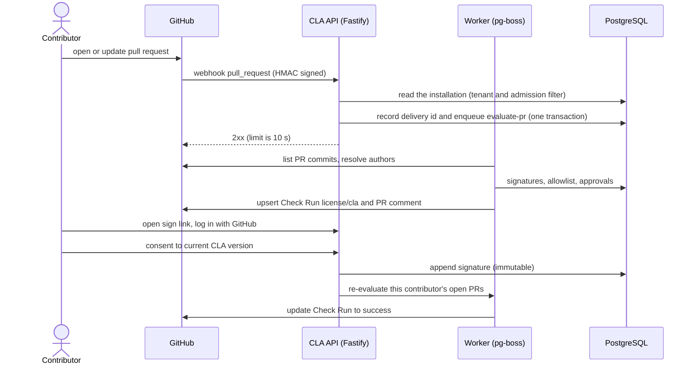

# Architecture

How the service is built and the rules the code must follow. [`README.md`](../README.md) has the short overview. The cross-cutting rules every change must respect are repeated in [`CLAUDE.md`](../CLAUDE.md); the schema is in [`data-model.md`](data-model.md), authentication and authorization in [`security.md`](security.md), the GitHub App in [`github-app.md`](github-app.md) and the directory tree in [`repository-layout.md`](repository-layout.md).

## Stack

| Layer | Choice |
|---|---|
| Runtime | Node.js 26 LTS (26.13.0 "Lithium", LTS since 2026-10-28), ESM only |
| Package manager | Yarn 4 (Berry) via Corepack, `nodeLinker: node-modules` |
| Language | TypeScript `~6.0.x`, strict (see [Decisions](decisions.md#decisions)) |
| Web | React 19.3, Vite 8 (Rolldown), TanStack Router (code-based) and Query 5, React Hook Form + zod, Tailwind CSS 4, `radix-ui` primitives |
| API | Fastify 5, `fastify-type-provider-zod` + zod 4, `@fastify/cookie`, `helmet`, `rate-limit`, `csrf-protection`, `fastify-raw-body`, `@fastify/static` |
| Database | PostgreSQL 18, Kysely, forward-only SQL migrations |
| Jobs | pg-boss (queue lives in Postgres, no Redis) |
| GitHub | GitHub App, `octokit` + `@octokit/webhooks` (ESM only) |
| Tests | Vitest 5 (`scripts`, `server` and later `web` projects), Testing Library, MSW 3, PGlite, Playwright |
| Deploy | Single container: Fastify serves API and the built SPA from one origin |

## Layering

```text
src/server/domain     pure functions (PR evaluation, coverage rules) - no I/O
src/server/services   orchestration, depends on ports
src/server/adapters   github/, db/, http/ routes, jobs/ - the only places with I/O
src/web               React SPA, talks to the API only through src/shared schemas
src/shared            zod schemas and API contract types; imports neither server nor web
```

Boundaries are enforced by ESLint, one block per directory (`scripts/eslint-layers.ts`, with a test that lints real snippets for every direction); the first two bullets under [Rules](#rules) give the details, including the allow-list of `src/server/domain`. Keeping the decision logic pure makes the 100% coverage and mutation gates cheap to satisfy honestly.

## How a pull request is checked



A PR passes when the **PR opener** and every non-exempt **commit author and committer** is linked to a GitHub user with a valid signature for the repo's active CLA. Covered means: same document, and the signature's major version equals the active major (minor edits never force re-signing). Commit emails are spoofable (anyone can commit as a signer's `ID+login@users.noreply.github.com`), which is why the opener must always be covered too. The committer is exempt when it equals the author or is GitHub's `web-flow` identity (id 19864447, verified 2026-11-02 with `GET /users/web-flow`); merge commits are skipped. With corporate CLAs (later), a valid individual signature **or** a valid corporate approval covers an author.

Outcomes: `success` (all covered), `failure` (unsigned authors and unlinked emails, listed with exact fix steps), and `in_progress` while a job runs. Each evaluation records its covering basis (signature, approval, allowlist rule or override) in `pr_evaluations`. A null commit author means an unlinked email: a blocking failure unless a maintainer records an audited per-commit override (repo plus commit SHA), which never implies a signature. `Co-authored-by` trailers carry only name and email, so they are resolved only in the `ID+login@users.noreply.github.com` form; otherwise they are advisory notes, never blocking. Bot and AI trailers are ignored. PRs with more than 250 commits fall back to paging the repo commits endpoint (the PR commits endpoint caps at 250), up to 2,000 commits; above that the PR fails closed with `commit_limit_exceeded` and the fix `split_pull_request`. Jobs always re-fetch current PR state and never trust the webhook payload.

## The GitHub App core

Every call to GitHub goes through the port `src/server/services/ports/github.ts`; the domain and the services never import Octokit. There are two implementations of it, the Octokit adapter (`adapters/github/octokit-client.ts`) and an in-memory fake, and one contract suite runs against both from one test per implementation. Every response is parsed with zod before it leaves the adapter (`adapters/github/schemas.ts`).

An installation token is obtained in one place, `GitHubApp.installationTokens`:

1. the installation gate (`InstallationGate`, `services/installation-gate.ts`) refuses a rejected, deleted, suspended or unknown installation before any request; it reads the stored row and asks the admission policy in force now, so a policy that no longer serves an account stops it at once;
2. the token cache (bounded, in memory, a token is reused until shortly before it expires) answers, or a single flight makes the concurrent callers of one installation share one mint;
3. the mint is `POST /app/installations/{id}/access_tokens`, signed with the App JWT (the current key, then the previous one when GitHub answers 401), and it goes through the rate limiter like any other call.

The gate is late-bound: it is the closed gate until the database is open and the admission policies are built, and then the stored gate. The evaluation job (E07) must ask it, because the pure `evaluationEligibility` reads stored state only; the gate is what also reads the live policy.

The rate limiter (`adapters/github/rate-limiter.ts`) is the only thing that decides how GitHub is paced, one lane per installation plus one for the App itself (`GET /app` and the check on start-up). A request waits for a lane slot (10 in flight per lane, 50 overall), for the 1 s spacing a write needs (a POST, PATCH, PUT or DELETE costs 5 points) and for a block GitHub announced (`retry-after`, `x-ratelimit-reset`, a secondary limit). It sleeps for at most 60 s and at most twice, then raises `GitHubRateLimitedError`; each sleep logs one `github.rate_limited` WARN. Octokit's own throttling and retry plugins are off. A GET that failed with a transient error is repeated after 1 s and 2 s; a POST is not repeated by the client.

Installation state: an installation is a row of `installations` keyed on the numeric GitHub installation id; `admission_status`, `deleted_at` and `suspended_at` say whether it is served (`installationEligibility`, and for a repository `evaluationEligibility` with the reasons `installation_rejected`, `installation_deleted`, `installation_suspended`, `repository_removed`, `repository_disabled`). The admission decision is the pure function `decideAdmission` in `domain/admission.ts` (the App owner is always served, then the numeric ids of `GITHUB_ALLOWED_ACCOUNT_IDS`; anything else, and any account that is not a user or an organisation, is rejected). The sync (`installation-sync*.ts`) reads the installations and each one's repositories from GitHub and writes in two transactions with the fetch between them; `reconcileOnStart` runs it once for every installation GitHub lists and marks the ones it no longer lists as deleted. Every write is one audit row in the same transaction. A repository is active under at most one installation: a repository that moves to another one is released by the new tenant's sync, and its row under the new tenant is a new row. An uninstall sets `deleted_at`; a repository that left sets `removed_at`; nothing is deleted.

## The evaluation engine

`src/server/domain/evaluation` is the whole decision as one pure function, `evaluatePullRequest(input)`, over plain facts: the opener, the commits, the policy, the signature facts, the allowlist, the known org members and the per-commit overrides. Its public surface is `index.ts` (a test pins the list of exports). The rules, in the fixed order the function runs them:

- **Actors.** The opener is always an actor. A commit with more than one parent is skipped (author, committer and trailers). The author is an actor; the committer is one unless it equals the author or is `web-flow`. A person with several roles is one actor. Commit SHAs are lower-cased everywhere, so case never matters.
- **Co-authors.** `Co-authored-by` trailers are the only text the engine matches, confined to `trailers.ts` and `trailer-identities.ts` (text is spoofable, so it can only add requirements). Only the final paragraph is read, at most 20 trailers per commit. Only the `ID+login@users.noreply.github.com` form resolves (to an actor of role `co_author` and type `Unknown`); every other trailer is an advisory `co_author_unresolved`, and bot and AI trailers (a login ending in `[bot]`, `noreply@anthropic.com`, Copilot) are ignored. The accounts that only trailers name are capped at 200 per PR (the lowest ids are kept, the commit that named a dropped one gets `too_many_trailers`); advisories are unique per commit and code.
- **Unlinked identities.** An author or committer GitHub could not link to an account is waived only by an audited per-commit override matched by lower-case SHA. The override is not an input to coverage and never implies a signature. Fixes name the SHA and role, never an address.
- **Coverage.** Only a person (a `User`, or an `Unknown` co-author) can be covered by a signature: same document, signature major equal to the active major, not revoked, lowest signature id wins. A `Bot`, `Organization` or `Mannequin` needs an allowlist entry. A signature beats an allowlist match as the stored basis. Allowlist entries match by numeric id: a `user` entry covers any account but a bot (including `Organization` and `Mannequin`, whose fix is `allowlist_account`), a `bot` entry covers `Bot` and `Unknown`, and `org_members` covers only `User` and `Unknown` of a known member. When several entries match: repository scope before installation scope, then kind `user`, `bot`, `org_members`, then the lowest entry id. An org with no membership fact has no members, so the job (E07-S04) must fail when a membership lookup fails instead of passing partial facts. Signatures and the allowlist are indexed once per evaluation, so the cost of an actor does not grow with them.
- **Listing.** `planCommitListing` chooses `pull_commits` (up to 250 commits, pages of 100), `repo_walk` (251 to 2,000, at most 25 pages of 100) or `refuse`. `collectRepoWalk` lists what the head reaches and the merge base and everything behind it do not; `verifyListing` compares the result with the count GitHub reports. A history with several merge bases (a criss-cross merge) lists too many commits and ends as a count mismatch, which fails closed. An exceeded listing fails with `commit_limit_exceeded` and `split_pull_request` without reading the commits; the limits are the constants of `listing-plan.ts`. With no active CLA the one failure code is `no_active_cla`.
- **Stored value.** `toStoredDetails` is the only writer of `pr_evaluations.details`. The schema (`src/shared/pr-evaluation-details.ts`, version 1, strict) holds numeric ids and codes only and bounds every list (500 actors, 500 unlinked findings, 500 advisories, so a row stays under 256 KiB); the uncovered actors and the findings without an override are kept first and `omitted` counts the rest, while the outcome and the failure codes always come from the full evaluation. Fixes are not stored: they are recomputed from the facts when a page is rendered, and the renderer (E09) must bound its own output.

## Authorization and tenant isolation

One instance serves several orgs, so every request acts for exactly one tenant (one GitHub App installation) and a person can do there only what GitHub says their numeric id may do (epic E11). Isolation has four layers: a role decision derived from GitHub, one guard used by every route, data access filtered by installation id, and the composite foreign keys of the schema ([data model](data-model.md)). The roles and the matrix are in the [Auth model](security.md#auth-model).

- **Route access.** Every route declares `config.access`: `public` (a closed list, `PUBLIC_ROUTES`), `authenticated` (any signed-in user, no tenant), `webhook` (only `POST /webhooks/github`, `WEBHOOK_ROUTES`), `operator` or `tenant` (`tenantAccess({ mode, resolve })`, `mode` `read` or `write`). `requireRouteAccess` (`adapters/http/route-access.ts`) records the table in `app.routeAccess`, and an `onReady` hook throws `RouteAccessError` naming every route whose declaration is missing or wrong, so an app with an undeclared route does not start. A route whose path has a tenant parameter (`:installationId`, `:repositoryId`, `:documentId`, `:signatureId`, `:entryId`) must be a `tenant` route (`authenticated`, `operator` and `public` are refused), and a `tenant` route that changes data must be `write`, because a write never reads the role cache. The guard that acts on the declarations is a `preHandler` after the CSRF check (`route-access-guard.ts`): `authenticated` needs a session (`401`), `operator` and `tenant` run the guards below. The pure `decide(requirement, facts)` of `domain/authz.ts` takes the decision.
- **Tenant guard order** (`tenant-guard.ts`): `requireAuth` (`401`), the resolver names the tenant (`tenant-resolvers.ts`: `byInstallationParam`, `byRepositoryParam`, `byDocumentParam`, `bySignatureParam`; `:installationId` is the internal `installations.id`, never GitHub's id, and a value that is not plain digits is `400`), the tenant is read with its installation id and its state judged (`domain/tenant-state.ts`), the role facts are asked (cached for a read, fresh for a write), `decide`, a `409` for a write to a suspended or deleted tenant, and only then the handler, which reads its tenant from `request.tenant` alone. `tenant-authorization.ts` takes the facts and `tenant-authorizer.ts` wires them to the lookups, the cache and the database; `tenant-queries.ts` has the reads.
- **Denials** follow one table and a role is never named in an error body: `401` without a session; `404 not_found` for a resource that is unknown, removed, of a rejected tenant, or in an installation where the viewer has no role (one answer, byte for byte but for the request id); `403 forbidden` for a viewer who has a role in the installation but too low a one; `409 installation_suspended` or `installation_deleted` for a write by someone allowed to make it; `502 github_unavailable`, `503 github_rate_limited` or `429 too_many_requests` (with `retry-after`) when GitHub could not say, never an empty list or an implicit allow. An installation that GitHub no longer serves while the stored row is still active (a late webhook: the token request says suspended or gone) is the same `404`, logged as the warning `installation_state_stale`.
- **Role facts** (`services/`): `createOrgAdminLookup` (`org-admin.ts`) and `createRepoAdminLookup` (`repo-admin.ts`) ask GitHub with the installation token by numeric id and give up after 5 s (`withRoleDeadline`, `role-deadline.ts`: the client port's own 10 s timeout and two repeats are too long for a request path). `RoleCache` (`role-cache.ts`, entries in `role-cache-entries.ts`, keys in `role-key.ts`) keeps an answer 60 s under (installation, viewer, scope) with single flight, a fresh lookup for every write, invalidation on logout and on a revoked authorization, and tells the lookup behind it whether it is still the current one (`LookupContext.isCurrent`); a lookup that was displaced or invalidated while it waited keeps nothing. `role-lookup-budget.ts` allows 30 uncached lookups a minute per person. `PROBE_BUDGETS` (`probe-budget.ts`: 100 for the installation list, 50 for the repository list, 10 for the denial path) bound the discovery of a repo-admin role (`repo-admin-discovery.ts`, `repo-admin-candidates.ts`); the lookup spends the budget, so the cache sits in front of the lookup. `adapters/http/upstream-failure.ts` maps the failures to `502`, `503` and `429`, and the cache is the `roleCache` slot of the app (`role-cache-slot.ts`).
- **Suspended, deleted, rejected.** The state is read from the database on every guarded request, and the role cache is bypassed for a tenant that is not active, because GitHub refuses its tokens. A rejected tenant is invisible (`404`). For a suspended or deleted organisation only the ledger of org admins (`installation_admin_seen`, `services/admin-ledger.ts`) can say who may read, and only org admins pass there; the owner of a user account is `installations.account_id`. Where a document sits is read by `services/document-placement.ts`: a repository that left the installation keeps its documents and signatures reachable for org admins only.
- **Operator.** An `operator` route runs `guardOperator` (`operator-guard.ts`, with `RouteGuardDeps`: the tenant dependencies plus `operators`) after `requireAuth`: `401` without a session, the uniform `404` for anyone `domain/operator.ts` does not name. The policy is built once at start-up by `services/operator-policies.ts` (`AppOptions.operators`, `InstallationWiring.operators`). The tenant guard never reads it, so an operator is a stranger to every tenant.
- **Tenant data.** Every data function over a tenant table takes a `TenantScope` (`{ installationId }`, `adapters/db/tenant-scope.ts`) and puts it in the `WHERE` of every statement; a job calls `assertRepositoryInTenant(db, scope, repositoryId)` before any write. The functions that meet another tenant by design are `listInstallationsForOperator`, `releaseTransferred`, `isActiveRepositoryOfAnotherInstallation` and `installationOfRepository`. The cross-tenant tests are generated from registries ([quality gates](quality-gates.md#testing)), and the source scan covers all of `src/server`, joins and `sql` templates included.

## The web app

`src/web` is a React 19 SPA (Vite 8, Tailwind CSS 4, code-based TanStack Router, TanStack Query) that Fastify serves from its own origin. It passes every gate the server passes. The rules it keeps (E17):

- **Serving.** `@fastify/static` is registered last, in a scope of its own, so its wildcard never shadows a route of the API. The file routes (`GET` and `HEAD` of `/*`) declare `config.access: 'public'` and `config.session: 'none'` (a page loads while the database is down) and stay under the global rate limit. A page of the app (a `GET` or `HEAD` that accepts HTML, outside `/api`, `/healthz`, `/readyz` and the webhook path, with no dot segment and no extension) falls back to `index.html` from a `preHandler`; any other miss, a directory and a dotfile included, is the `not_found` envelope. No CORS plugin is installed, so a page on another origin cannot read an answer. Hashed files under `/assets/` are `immutable` for a year, every other file is `no-cache` with its ETag.
- **Contracts.** The routes the SPA calls are described once, by `defineRoute` descriptors in `src/shared` (`contract.ts`, `auth-contract.ts`, `meta.ts`); the server registers its handlers from them as they are touched, and the client in `src/web/api` (`createApiClient`) is built on the same descriptors, not on hand-written types. Layering is unchanged: `src/web` never imports `src/server`.
- **Strings and time.** All user-visible text goes through `t()` from `useT()` (the English catalog `src/web/i18n/messages.ts`; a wrong key or a missing placeholder fails `tsc`, and an inline text in JSX fails ESLint). `I18nProvider` sits outermost, above the error boundaries. `formatUtc` is the evidence format; the viewer's time zone comes from the `Intl` defaults.
- **User text.** Every string a person controls (a login, a name, a repository, a rationale) reaches the screen through `UserText`, or `visibleText` where markup cannot go (a `Select` option): React escapes it, `<bdi>` isolates its direction, and controls, lone surrogates, the bidi marks, embeddings, overrides and isolates and U+FEFF are written out as `<U+XXXX>`. `maxLength` cuts at a whole character and keeps the full text for assistive technology. The stored value is never changed. `dangerouslySetInnerHTML` appears nowhere.
- **Primitives.** `src/web/ui` holds the accessible primitives (form controls, tabs, badge, dialogs, data table, cursor pager) and is the only place that imports `radix-ui`. Overlays draw their own backdrop and lock scrolling with the `scroll-locked` class, because Radix's overlay injects a `<style>` element that `style-src 'self'` refuses.
- **Errors.** An error screen takes its words only from `errors.<code>` in the catalog through `errorMessage`, never from `error.message` or server wording. The error boundaries log `error.name` and the request id to `console.error` and send nothing anywhere. The footer is rendered beside `RootErrorBoundary`, not inside it. A new `AppError` code the SPA can see joins `src/shared/error-codes.ts` and the `errors.*` catalog together.
- **Routing and session.** Routes live in `src/web/router.tsx` and spread `withAccess('public' | 'authenticated')`, which has no default. An authenticated route is guarded in `beforeLoad` by a full-page navigation to `/api/auth/login?return_to=<path+search>`. The session is the query `['auth','session']`; the API client reads the CSRF token from it on every request. A `401` while a session is held clears the query cache, sets the session to anonymous, marks it ended and shows the banner. Logout clears the cache and goes to `/`. The shell (skip link, header, navigation, `main`, live region, footer) is the router's `InnerWrap`, and a route sets its `staticData` title and `headerSlot`.
- **Storage.** Web Storage holds only `cla.theme` (a theme name), and only `src/web/theme/storage.ts` touches it. The theme is applied by a blocking same-origin script, `/theme-init.js`, so the CSP needs no `unsafe-inline`; `data-theme` always holds the resolved theme.
- **No eval.** `src/web/zod-config.ts` sets Zod to `jitless` and is the first import of `main.tsx`: Zod's default probe of `new Function('')` would be reported as a CSP violation on every page load.

## Rules

- `src/shared` imports neither `src/server` nor `src/web`. `src/web` never imports `src/server` and vice versa. Enforced by ESLint only (Knip does not check layering): one block per directory in `scripts/eslint-layers.ts`, appended at the end of `eslint.config.mjs`; a later block REPLACES the rule for its files, so each block repeats what it inherits. The patterns are regular expressions on RELATIVE specifiers (a glob on the bare name would also reject `node:stream/web` and `react-dom/server`), dynamic `import()` is covered by `no-restricted-syntax` selectors (`no-restricted-imports` ignores it), and `scripts/eslint-layers.test.ts` lints real snippets for every direction with the real blocks.
- Decision logic (PR evaluation, signature coverage, allowlist matching) lives in `src/server/domain` as pure functions with no I/O. I/O only in `src/server/adapters`. Inside `src/server/domain` ESLint uses an allow-list, not a deny-list of I/O modules: only its own files (no `..`), `src/shared` and `zod` may be imported (so no Node built-in at all, no I/O package, and nothing of `app`, `boot`, `config`, `adapters`, `services` or `src/web`), no dynamic `import()`, no `fetch`, `process`, `require`, `WebSocket`, `XMLHttpRequest`, `EventSource`, `Date`, `Temporal`, `performance` or `crypto` and no `Math.random` (the same facts must give the same answer), and no property access on `globalThis`, `global`, `self` or `window`. The `*.test.ts` files next to the domain code follow the same rules and may also import `vitest` (a second block in `scripts/eslint-layers.ts`). Extend the allow-list in `scripts/eslint-layers.ts` (with a test) when a pure module is really needed.
- Validate every external input (HTTP, webhook payloads, GitHub API responses, env) with zod at the boundary. Share schemas through `src/shared`.
- Webhook handler order (`POST /webhooks/github`, `adapters/http/webhook-routes.ts`; the scope has no body parser, its own request id generator, and `fastify-raw-body` keeps the bytes GitHub sent): (1) `onRequest`: the failed-signature throttle turns an address with more than 30 failures in 60 s away with `429 webhook_throttled` before its body is read, and the `Content-Type` header is held off the request so Fastify's own 415 cannot precede the signature check; (2) the body size, 10 MiB for this route only (`413 webhook_payload_too_large`); (3) `preValidation`: HMAC-SHA256 on the **raw body** against each configured secret (both always computed) with `crypto.timingSafeEqual`, the legacy `X-Hub-Signature` header ignored, `401 webhook_signature_invalid` for every failure, `webhook.secret_previous_used` at most once a minute on a rotation; (4) the envelope in a fixed order: headers `400 webhook_header_invalid`, media type `415 webhook_unsupported_media_type`, the App target `400 webhook_wrong_app`, JSON `400 webhook_payload_invalid` (a BOM-prefixed body is refused); (5) the zod schema of the event (`adapters/github/webhook-schemas.ts`, unknown keys stripped, failure lists field paths only), an event with no schema passing unvalidated to the router; (6) the pure routing table (`domain/webhook-routing.ts`): `ping` answers `200 pong`, a delivery that starts no job answers `202 ignored` with a reason, the others map to one job that carries numeric ids and the delivery id only; (7) the tenant and admission filter (`services/tenant-filter.ts`): the installation is read by GitHub installation id (a database read, never a GitHub call) and served only if admitted, not deleted and not suspended, in that order, then the repository is checked for being active under another installation; (8) in **one transaction** the `webhook_deliveries` row (`on conflict do nothing`) and the job: a new row `202 accepted`, a processed one `200 duplicate` without a send, an unprocessed one sent again under the delivery id as idempotency key (`202`, or `200 duplicate` when a live job already holds the key and will finish it), a failure rolls everything back and answers `503 webhook_enqueue_failed`; a ping or ignored delivery inserts no row and a delivery replaced by a sync is recorded as the sync. Steps 7 and 8 run under an 8 s deadline counted from arrival (`503 webhook_timeout`, no statement after the abort, rollback). Every delivery ends with one `webhook.received` line (`onResponse`). No GitHub API calls in the request path (10 s limit). Jobs re-fetch PR state and never trust the payload. The error handler sends `AppError(status, code, details?)` as the E04 error body (code and a plain-object `details`; the message stays the standard status text, 5xx is logged), which is how the `webhook_*` codes are thrown.
- Concurrency: serialise evaluation per (repo, PR) **without dropping newer sends**. pg-boss `short` and `exclusive` policies drop a second send; pick a policy that queues per key (check the pg-boss policy docs; candidates are `singleton` or `key_strict_fifo`). The job reads the current head SHA at run time, re-checks it before writing the Check Run and comment, and reads signatures last. PGlite is single-connection, so concurrency tests run against real Postgres.
- `issue_comment` handling: `created` only, issue must be a PR, sender must not be a Bot, a line must be exactly `/recheck`, rate-limited per PR. Also handle `check_run` and `check_suite` `rerequested`, and `pull_request` `closed` (prune pending work). A scheduled sweep re-evaluates open PRs to catch missed deliveries.
- Check Run name is the constant `license/cla`. Do not rename it.
- PR evaluation: the PR opener **and** every non-exempt commit author and committer must be covered (commit emails are spoofable). Committer is exempt if equal to author or GitHub `web-flow`; merge commits are skipped. Covered = same document and signature major equals the active major. List PR commits (cap 250, then page repo commits); use author and committer numeric ids. A `null` or `{}` author means an unlinked email: a first-class failure state with fix instructions, overridable only by an audited per-commit `commit_overrides` row that never implies a signature. `Co-authored-by` trailers have no numeric id: resolve only the `ID+login@users.noreply.github.com` form, otherwise advisory only; ignore bot and AI trailers. Classify bots from the PR opener's account type plus numeric id or app slug, never from email or login strings. Record the covering basis in `pr_evaluations`. The engine is described under [The evaluation engine](#the-evaluation-engine).
- Authorization: use the installation token and numeric ids to check org role or repo permission, cached with a short TTL. Every query filters by installation id; cross-tenant tests are mandatory. Role matrix is in [Auth model](security.md#auth-model); the guard, the denial table and the role cache are under [Authorization and tenant isolation](#authorization-and-tenant-isolation).
- Output encoding: CSV export prefixes cells starting with `=`, `+`, `-`, `@`, tab or CR. PR comments and check summaries escape markdown, wrap names in code spans, neutralise `@` and `#`. Hostile-name tests are mandatory.
- Cookies: `__Host-` prefix, `HttpOnly`, `Secure`, `SameSite=Lax`, idle and absolute expiry. Two cookies: the session `__Host-cla_session` (the plain 43-character id; only its hash is stored) and the login attempt `__Host-cla_oauth` (signed with `SESSION_SECRET`, `{ s, v, r, t }`: state, PKCE verifier, checked return path, start time; `Max-Age=600`, and refused server-side after 600 s whatever the browser sends). Login uses that short-lived Lax cookie plus PKCE (S256), a **new session id** at the callback, relative-only `return_to`, no mutation on GET except the callback itself (the one GET that writes). The GitHub user token is a `Secret`, used once, revoked best-effort and never stored. A failed login redirects to `/login/failed?reason=` with one of `state_mismatch`, `access_denied`, `exchange_failed`, `github_unavailable`, `unsupported_account`, `bad_request`. CSRF token plus `Origin` check on state changes (next rule); the webhook route is exempt and relies on HMAC only. Match that exemption on the routed path (`request.routeOptions.url` against `WEBHOOK_PATH`), never on `request.url`: the router also resolves percent-escaped, fragment and absolute-form spellings of the path. Delete sessions on a `github_app_authorization` revoke event. Set `trustProxy` correctly or rate limits key on the proxy IP.
- CSRF and request bodies: a global `preHandler` checks `POST`, `PUT`, `PATCH` and `DELETE` in a fixed order, `Origin` equal to the origin of `PUBLIC_BASE_URL` (`403 origin_not_allowed`), a live session (`401`), then `x-csrf-token` (`403 csrf_invalid`); `GET`, `HEAD` and `OPTIONS` are never checked. The token is `base64url(hmac_sha256(SESSION_SECRET, 'csrf:' + csrf_secret))`, so rotating `SESSION_SECRET` invalidates every token. A route opts out only with `config: { csrf: 'exempt' }`, and only when it is on `CSRF_EXEMPT` (`adapters/http/csrf-routes.ts`; `SETUP_ROUTES` is the second closed list, E19-S06); registering any other flagged route fails at boot. The webhook route sets `csrf: 'exempt'` and `rateLimit: false`, and the matching is on the routed path (`request.routeOptions.url`, the pattern the router resolved) compared with `POST` and `WEBHOOK_PATH`, never on `request.url`, so a query string, a fragment, a percent-escape or an absolute-form target cannot move a request in or out of the exemption. The webhook scope therefore answers a bad signature `401`, never `403 origin_not_allowed` or `403 csrf_invalid`, and needs no `Origin`, session or token; the scope also keeps its own request id generator, its failed-signature throttle and its parsers, and the login's `preValidation` session lookup, the rate limit and `Cache-Control: no-store` (`/api/auth` only) never run on or alter it. Only `application/json` has a body parser (`415 unsupported_media_type` otherwise). Fastify validates a route's schema before the `preHandler` hooks, so a route that reads a body parses it in its handler when the Origin, session and CSRF order must win over validation errors; logout is the first such route.
- Rate limiting (`adapters/http/rate-limit.ts`): a global budget of 600 requests a minute per client address (`request.ip`, IPv6 by /64), overridden per route with `config.rateLimit` built by `routeRateLimit()`; a budgeted GET route sets `exposeHeadRoute: false` (the plugin keeps one store per registered route, so a HEAD twin would double the budget). `config.rateLimit = false` is allowed only for the routes on the closed `RATE_LIMIT_EXEMPT` list (the webhook), checked at registration. A request no route answers shares the global budget, limited from an early hook. The session lookup is a `preValidation` hook, after the route's own limit, so an over-budget request costs no query and a route outside the limit does no lookup, and neither does a request no route answers or a route that declares `config.session = 'none'` (`/healthz` and `/readyz`, which must answer while the database is down and stay inside the global budget); a route that keys its budget on the caller sets `hook: 'preHandler'` in its `config.rateLimit`. `trust_proxy_suspected` is logged at most once a minute while `TRUST_PROXY` is `false` and a forwarding header arrives.
- SPA is served by Fastify from the same origin ([The web app](#the-web-app)). No tokens in `localStorage`; the browser never sees a token at all.
- Poison jobs: bounded `retryLimit` plus a dead-letter handler that sets the Check Run to `failure` with a `/recheck` hint.
- Network metadata (IP, user agent) is not recorded unless an explicit config flag enables it. That includes the log: the request serializer in `src/server/adapters/http/logger.ts` emits method and path only (never headers, cookies, query string, body or client address), and a test pins it.
- Audit writer: every mutation records one `audit_log` row in the same transaction through `appendAudit(trx, entry)` (`src/server/services/audit.ts`). It takes a Kysely `Transaction`, not the database handle, and exports no update or delete. `action` is a member of the closed `AUDIT_ACTIONS` tuple (`src/shared/audit.ts`); `actorGithubId` (the branded `GithubId` of `src/shared/github-id.ts`) may be `null` only for `SYSTEM_ACTIONS` and `installationId` only for `INSTANCE_ACTIONS`. Any other breach throws `AuditEntryInvalid` (a 500 that rolls the transaction back; the message names fields and rules, never values). The metadata allowlist is in [Data model](data-model.md).
- Route audit rule: every `POST`, `PUT`, `PATCH` or `DELETE` route under `/api` declares exactly one of `config.audit` (an `AUDIT_ACTIONS` member) and `config.auditExempt` (`webhook`, `session` or `setup`). `requireAuditedRoutes` (`adapters/http/audit-routes.ts`, called in `buildApp` before any route) throws `UnauditedRouteError` naming the route at registration, so an app with an unaudited mutation cannot start. It also covers a route whose first segment could answer `/api/...`: `/*`, `/:x`, `/a*`, `/api*`.
- Server start-up order (`src/server/boot.ts`): `loadConfig(process.env)` (invalid variables are reported by NAME, exit code 1), logger, `logGithubApp` (the configuration line, and a WARN when the App is not configured), `logAuth` (the login configuration line, `auth.configured` or `auth.not_configured`), the GitHub self-check (`GET /app` must answer with the configured App id and the key that signed it; a 401 stops the start in production only, an outage or a rate limit is a WARN `github.app_check_deferred` and the start goes on), database, the admission policies, the gate bound, the installations reconciled, `buildApp`, `listen`, then SIGINT and SIGTERM close the app, which destroys the database; open requests get `shutdownTimeoutMs` (10 s) before their connections are dropped and the exit code becomes 1, and a second signal drops them at once. The HTTP limits (timeouts, keep-alive, 1 MiB body) are explicit in `adapters/http/limits.ts`; failures that never reach a route (bad URL escape, parser errors, oversized headers) are answered by `adapters/http/framework-errors.ts` with the same body, request id and security headers. The runtime connects as `cla_app` (`DATABASE_URL`); only `yarn db:migrate` uses the owner (`MIGRATION_DATABASE_URL`). Wrap every secret in `Secret` (`reveal()` is the one explicit way out). Error responses never carry an exception message.
- No legal text ships by default; maintainers upload their own CLA.
